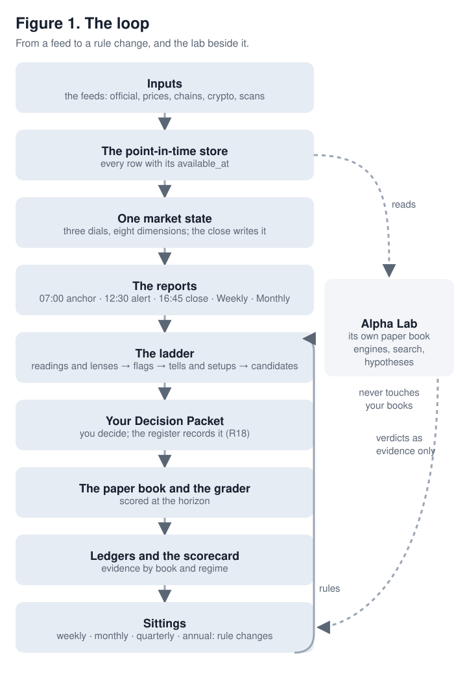
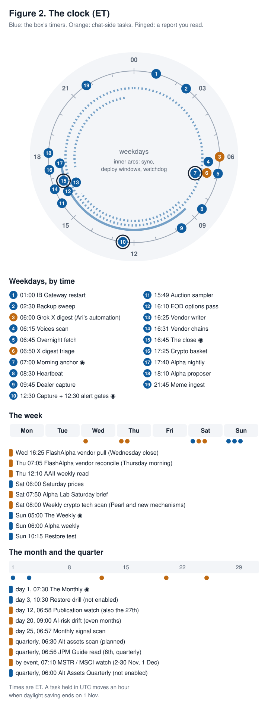
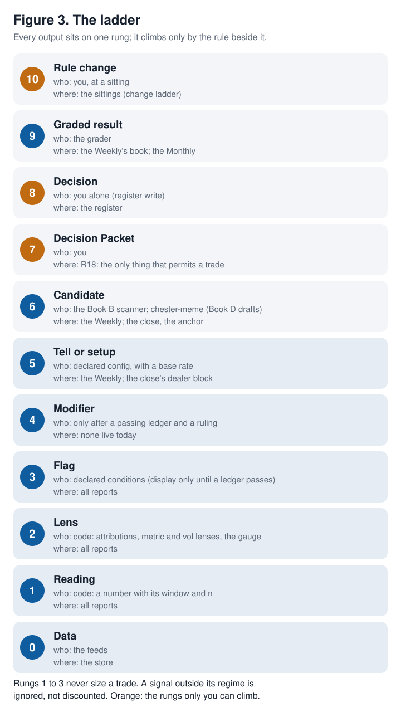
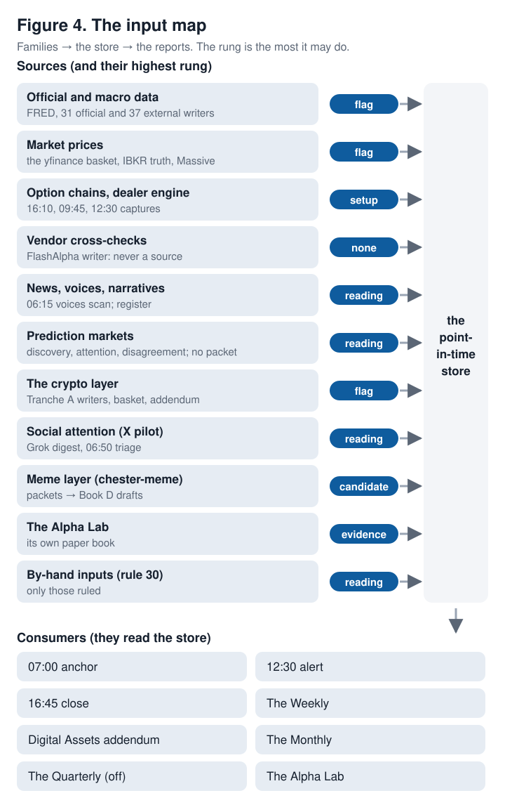
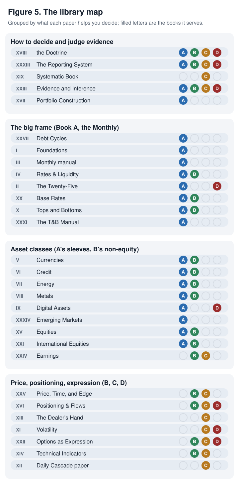

# The Master Guide

### How the whole system fits together, what each part may do, and how to use it

**As of:** 23 October 2026 · **As built:** chain-5 (the fifth chain, stitched 23 Oct 2026 onto main after chain-3's merge: chain-4 (a50-dealer-store, b48-scoreboard and a52-doctrine-2-pack), then a54-relative-volume, a55-box-fixes, b51-registry-html, a56-batch14-a1 and b52-batch14-a2) · **Refreshed:** at every chain merge

---

This is the front door. It shows how the reports, the inputs, the books and the evidence fit together, what each part is allowed to do, what has been proven so far, and what to do each day, week and month. It summarises and links; it does not replace the three references behind it:

- **The Reporting System: A Reader's Guide** ([reporting-system-whitepaper.md](whitepapers/reporting-system-whitepaper.md)) explains how the reports work.
- **The Operating Doctrine** ([operating-doctrine-whitepaper.md](whitepapers/operating-doctrine-whitepaper.md)) is the rulebook. This Guide quotes its rules and never restates them differently.
- **The library guide** ([white-paper-library-guide.md](white-paper-library-guide.md)) catalogues the 27 papers.

Everything below is checked against the code and config on chain-5. Where something is specified but not built, it says "not built" and where the plan stands. Work still on its own branch appears only under **Landing next**, labelled as such. Risk is given in the Card's percentages, never in dollars. No vendor figure, no real position and no Brookfield-group instrument appears here.

**The one picture to keep in mind is a newsroom with a research lab and a trading desk.** The feeds are the wires. The market-state object is the single editor's view of the market. The reports are the editions. The Alpha Lab is the research lab next door. You are the desk, with four books. The Doctrine's rules and switches are compliance. The register, the grader and the ledgers are the scorekeeper.

---

## Part 0. The whole system in ten minutes

**In three lines.** Feeds land in a store where every row carries the instant it became knowable. One market state is computed from it each evening, and every report reads that state rather than computing its own. The reports raise readings, flags and candidates; only your Decision Packet permits a trade, and every decision is graded so the rules can change at a sitting.

### The loop, in words

1. **Inputs.** About seventy writers (33 official, 37 external, the yfinance basket of 124 symbols, the option chains, the crypto layer, the scans) land in **the point-in-time store**. Every row carries `available_at`, the instant the system could have known it, so a replay of an old day sees only what existed then.
2. **One market state.** The 16:45 close computes the **market-state object**: three dials (Macro, Volatility, Gamma) and eight dimensions, from the declared rules in `config/market_state.yaml`. It is the only writer. Every other report reads it through `regime.latest()`; none recomputes it.
3. **The reports** read the store and the state. They raise outputs on **the ladder** (Part 3): readings and lenses, flags, tells and setups, candidates. None of them may place a trade or write a decision.
4. **Your Decision Packet.** You decide. A packet carries the edge, the counterparty, the instrument, the size by the Card's percentage, the exit written before entry and the regime stamp. "No Decision Packet, no trade" (Doctrine Rule 18). The register records it; the register's commands are yours alone.
5. **The paper book and the grader.** Every decision, and every graded candidate you declined, is scored at its horizon.
6. **Ledgers and the scorecard** collect the evidence by book and regime.
7. **Sittings** (weekly, monthly, quarterly, annual) change the rules, never between sittings.
8. **The Alpha Lab** reads the store read-only, runs its own paper book and sends verdicts back as evidence. It never touches your books.

### The reports at a glance

| Report | When (ET) | Reading time | Book | Highest rung | What you do with it |
|---|---|---|---|---|---|
| The morning anchor | weekdays 07:00 | about 10 minutes (no configured target) | C (and B's brackets) | Flag; setups proposed in the dealer block | Read the dials, the volatile-day flag (all four arms, printed, never applied), the gauge, the pre-market line and the signal lines. No Book C drafts exist yet. |
| The 12:30 alert | weekdays 12:30, only if a gate opens | 2 minutes | none | Flag (an alert) | Read it and wait for the close. |
| The close | weekdays 16:45 | 5 minutes (configured) | all, as record | Setup proposed (the dealer block) | Check what held and broke, the meme line, the book and the switches. |
| The Weekly, with the Digital Assets addendum | Sunday 05:00 | 20 minutes, plus 5 for the addendum (configured) | B (A for context, D through the addendum) | **Candidate** (Book B) | Select up to three Book B candidates; read the scorecard and the lab line; post-mortems. |
| The Monthly | the 1st, 07:30 | 55 minutes (configured) | A | Reading and flag; no packet is generated from it | Set Book A's stance within its band at the monthly sitting. |
| The Alternative Assets Quarterly | second Saturday after quarter-end, 06:00 | 90 minutes (configured) | A's sleeves | Reading | Built, **disabled**: the first edition is planned for January 2027. |
| The open note | weekdays 09:50 | 2 minutes (the order) | C | Confirm or cancel Book C's 07:00 drafts, never add | Optional while Book C is inactive. Built: dry runs until `live_from` 2026-10-26; its timer is enabled by hand. |
| The evening note | Sunday to Thursday 21:30 | 1 minute; 3 on Sunday (the order) | none | Reading | Optional; never act on it at night. Built: dry runs until `live_from` 2026-10-26; its timer is enabled by hand. |

### The week at a glance

| When | What | Time |
|---|---|---|
| Weekdays 06:50 (optional) | The X triage push: attention only | 1 minute |
| Weekdays 07:00 | The morning anchor | 10 minutes |
| Weekdays 09:50 (optional) | The open note | 2 minutes |
| Weekdays 12:30, if it arrives | The 12:30 alert: read, then wait for the close | 2 minutes |
| Weekdays 16:45 | The close | 5 minutes |
| Sunday to Thursday 21:30 (optional) | The evening note: never act on it at night | 1 minute; 3 on Sunday |
| Saturday or Sunday | The lab's Saturday brief, and the Saturday crypto scan | 10 minutes |
| Sunday | The Weekly and the addendum; select up to three Book B candidates; post-mortems | 45–60 minutes |
| First weekend of the month | The Monthly and the monthly sitting: Book A's stance | 90 minutes |
| Quarterly | The JPM read; the lab's quarterly page; from January, the Quarterly | as needed |

### What is proven so far

**Very little, and the system says so.** Twenty-four signals have a gate that has given a verdict.
- **One has passed:** SR-1's style regime (value against growth after a growth extreme). Even that is display only until the Doctrine monthly of 7–8 November rules on its rights.
- **Fourteen have failed:** the rates driver, the yen unwind, the false-bottom gate, the valuation strip, the Fed–market divergence split, the auction-stress flag, net supply against the term premium, the two crypto flags (S-2's ETF flows and S-3's leverage), the opening setup's positioning composite (OS-6), the two secondary-note studies (SN-1, the release-day first hour; SN-2, after-hours earnings), the bank-stress classifier's base rate (ST-R6.59c, the fourth chain), and the wealth-effect impulse against real consumption (ST-R6.66c, the fifth chain).
- **Nine are insufficient:** too few episodes to judge, OS-9's outcome ledger and OS-12c's relative-volume ledger (the fifth chain) among them.

Twelve more are **accruing** a sample: the dealer scorecard's seven tests (H6, the level clusters, pre-registered on the third chain), the three Book B pivot setups, the prediction-market archive and the crypto froth gauge. Everything else, about sixty flags, lenses, setups, engines and composites, is **untested context**. Nothing in the Alpha Lab's eleven engines has passed. The full table is Part 5.

### The one rule that matters most

**No Decision Packet, no trade** (Doctrine Rule 18). And **top-down sets the budget; bottom-up spends it**: a lower horizon may veto but never enlarge (Doctrine Rule 19). Everything a report prints is an input to a packet, never a trade on its own.

Deeper: the Reader's Guide, Part I (what the system is for) and Part X (reading the reports); the Doctrine's Card and Part VI.

---

## Part 1. The clock: everything that arrives, and when

**In three lines.** Twenty-eight timers run on the box, all in ET; seven of them produce something you read. Thirteen chat-side entries (twelve claude.ai tasks, one of them planned and not yet created, plus your own Grok automation) feed you directly or feed the box through Drive. A few items arrive only when an event makes them: the 12:30 alert, volatility events and release days.

Figure 2 is generated by `tools/figures/master_guide.py` from the timer files and `docs/master-guide/chat-tasks.yaml`, so it changes when they do. The two secondary notes are on the dial now that their timer files exist.

### Table 1. The box's timers

Read from `deploy/systemd/*.timer`. "Enabled" says who turns it on: the deploy enables the fourteen timers in `DEPLOY_TIMERS` (`scripts/deploy_remote.sh`); the rest are enabled by hand on the box, each starting a new data line or a new report (chain-2's and chain-3's box sheets). This Guide cannot see which are enabled on the box today; it says only who enables each.

<!-- table:timers -->
| Timer | OnCalendar (as the unit has it) | When (ET) | What it produces | For you | Enabled |
|---|---|---|---|---|---|
| `ibgateway-restart` | `*-*-* 01:00:00 America/New_York` | daily 01:00 | restarts IB Gateway, clear of IBKR's reset | background | by hand, after the witnessed clean start |
| `ibgateway-watchdog` | `*:0/5` | every 5 minutes | probes IB Gateway's health | background | by hand, after the witnessed clean start |
| `chester-backup` | `*-*-* 02:30:00 America/New_York` | daily 02:30 | the encrypted off-box backup; the sweep copies the Drive inboxes (X pilot, AAII, lab) onto the box | background | by the deploy |
| `chester-voices` | `Mon-Fri 06:15 America/New_York` | weekdays 06:15 | the voices scan: officials, desks, news (stored, sourced) | background | by the deploy |
| `chester-overnight` | `Mon-Fri 06:45 America/New_York` | weekdays 06:45 | overnight prices, the early writers, the loggers, the meme ingest's morning pass | background | by the deploy |
| `chester-morning-anchor` | `Mon-Fri 07:00 America/New_York` | weekdays 07:00 | **the morning anchor**, by email | you read it | by the deploy |
| `chester-heartbeat` | `*-*-* 08:30:00 America/New_York` | daily 08:30 | the freshness check: STALE and PENDING by name | background (alerts) | by the deploy |
| `chester-ibkr-sync` | `Mon-Fri 09..17:00/30 America/New_York` | weekdays, every 30 minutes, 09:00 to 17:30 | Portfolio Truth from IBKR, read-only | background | by the deploy |
| `chester-dealer-0945` | `Mon-Fri 09:45 America/New_York` | weekdays 09:45 | the 09:45 chain capture and its exposure profiles | background | by hand |
| `chester-dealer-1230` | `Mon-Fri 12:30 America/New_York` | weekdays 12:30 | the 12:30 capture and the gates; **the 12:30 alert** only if one opens | you read it (when sent) | by hand |
| `chester-auction` | `Mon-Fri 15:49 America/New_York` | weekdays 15:49 | the closing-auction tick sampler | background | by the deploy |
| `chester-eod` | `Mon-Fri 16:10 America/New_York` | weekdays 16:10 | the EOD pass: the settled chains, prices, FRED, the official and external writers | background | by the deploy |
| `chester-flashalpha` | `Mon-Fri 16:25 America/New_York` | weekdays 16:25 | the vendor writer: a cross-check, never a source | background | by hand |
| `chester-vendor-chains` | `Mon-Fri 16:31 America/New_York` | weekdays 16:31 | Massive's SPX and SPCX chains (15-minute delayed; ingestion only) | background | by hand |
| `chester-daily-close` | `Mon-Fri 16:45 America/New_York` | weekdays 16:45 | **the close**, the market-state object, the ledgers' outlooks | you read it | by the deploy |
| `chester-crypto-basket` | `*-*-* 17:25 America/New_York` | daily 17:25 | the crypto basket and Tranche A's writers; PRL; Saturdays, the mechanism scan | background | by the deploy |
| `chester-alpha-nightly` | `Mon-Fri 17:40 America/New_York` | weekdays 17:40 | the Alpha Lab's nightly loop (its own paper book) | background | by hand |
| `chester-alpha-proposer` | `Mon-Fri 18:10 America/New_York` | weekdays 18:10 | the lab's one model call: at most three hypotheses | background | by hand |
| `chester-meme-ingest` | `Mon..Fri,Sun *-*-* 21:15 America/New_York` | Mon to Fri and Sun 21:15 (moved from 21:45 so its drafts are in before the evening note) | chester-meme's packets into the Book D drafts table | background | by hand (restarted for the new time) |
| `chester-prices-saturday` | `Sat *-*-* 06:00 America/New_York` | Saturday 06:00 | Friday's continuous bars | background | by the deploy |
| `chester-weekly` | `Sun 05:00 America/New_York` | Sunday 05:00 | **the Weekly** and the Digital Assets addendum | you read it | by the deploy |
| `chester-alpha-weekly` | `Sun 06:00 America/New_York` | Sunday 06:00 | the lab's weekly loop: re-fits, rebalance, agenda, verdicts | background | by hand |
| `chester-restore-test` | `Sun *-*-* 10:15 America/New_York` | Sunday 10:15 | restores the newest backup and checks it | background | by hand |
| `chester-monthly` | `*-*-01 07:30 America/New_York` | the 1st, 07:30 | **the Monthly** (Regime & Allocation) | you read it | by the deploy |
| `chester-quarterly` | `Sat *-01,04,07,10-08..14 06:00 America/New_York` | second Saturday after quarter-end, 06:00 | the Alternative Assets Quarterly | you read it (from January) | **disabled** (ships off; first edition Sat 9 Jan 2027) |
| `chester-deploy` | `Mon-Fri *-*-* 09..15:05,35:00 America/New_York; Mon-Fri *-*-* 17..22:20,50:00 America/New_York; Mon-Fri *-*-* 23:20:00 America/New_York; Sat *-*-* *:05,35:00 America/New_York; Sun *-*-* 00..03:05,35:00 America/New_York; Sun *-*-* 07..23:05,35:00 America/New_York` | every 30 minutes inside the operating windows | the self-deploy: unit files, never a restart | background | by the deploy |
| `chester-open-note` | `Mon-Fri 09:50 America/New_York` | weekdays 09:50 | **the open note**: the 1000 report's role; dry runs until `live_from` 2026-10-26 | you read it (optional; mandatory on volatile days once Book C is active) | by hand |
| `chester-evening-note` | `Mon..Thu,Sun 21:30 America/New_York` | Sunday to Thursday 21:30 | **the evening note**: no rights; dry runs until `live_from` 2026-10-26 | you read it (optional) | by hand |
<!-- /table -->

Three things the table does not show:
- The 16:10 EOD pass and the 06:45 pass are the two main feed runs; the 16:45 close re-pulls the day's prices before it writes the market state.
- The self-deploy copies unit files only. A changed unit that was running is named in the heartbeat as `restart pending`, and **you** run the restart: no session or timer ever does.
- The Gateway's restart and watchdog wait behind one witnessed clean start; until then IB Gateway is not running on a timer.
- The old monthly restore drill is retired (a47-chain3, ruling 6): its unit files are gone, and the weekly restore test is the one restore check.
- The fourth chain adds no timer and changes none: the open and evening notes' services gain one comment each (their limits kept as starting values), and the dealer store and Batch 12's two writers ride units that already run.

### Table 2. The chat-side tasks, and your own automation

The repo's record of these is `docs/master-guide/chat-tasks.yaml` (no prompts, no secrets). A status is one of five words: active, pilot, retiring, retired and **planned** (a task specified but not yet created; accepted as a status word on 19 October 2026, R15). Times are ET. **A task the scheduler holds in UTC moves an hour on the ET clock when daylight saving ends on Sunday 1 November**: 12:00 UTC is 08:00 ET until then and 07:00 ET after.

<!-- table:chat-tasks -->
| Task | When (ET) | Writes | Read by | Rights | Status |
|---|---|---|---|---|---|
| Grok X digest (Ari's automation) | daily 06:00 | Drive chester-x-digest/x-digest-YYYY-MM-DD.md | the X digest triage; the box's nightly sweep copies the folder into the inbox (scripts/rclone_sync.sh) | attention only; an X post never earns measurement rights by volume alone | pilot |
| X digest triage | daily 06:50 | Drive chester-vendor-checks/x-triage/ (x-attention-ledger.csv, x-voices-ledger.csv) and a push summary | the box's sweep copies the ledgers in; the Digital Assets addendum reads them (daily_cascade/digital_addendum.py) | attention, voices and rumour tracking only; candidates go to the intake for Ari's ruling | pilot |
| AAII weekly read | Thursday 12:10 | Drive chester-vendor-checks/aaii/aaii-weekly.csv (one row a week) | the sweep pulls it into ~/chester-data/inbox/aaii; altdata/sources/aaii.py reads it | a reading (positioning), no decision right | active |
| Alpha Lab Saturday brief | Saturday 07:50 | Drive chester-vendor-checks/lab-inbox/ (at most five short-term and five medium-term hypotheses) | alpha/inbox.py, pre-registered at the file's Drive creation time | hypotheses for the lab only; never a candidate, packet or trade | active |
| Weekly crypto tech scan (Pearl and new mechanisms) | Saturday 12:00 UTC (08:00 ET until 1 Nov, 07:00 ET after) | a message only | Ari | none (a read) | retiring |
| Publication watch (the reading shelf) | the 12th and 27th, 06:58 | a reading-watch file that Ari commits to docs/scans/ | the library (the papers' refresh queue) | none (a read) | active |
| Monthly signal scan | the 25th, 06:57 | docs/scans/signal-scan-YYYY-MM.md, for Ari to rule on | the signal-triage register (Ari's rulings) | none until ruled | active |
| AI-risk consensus-drift scan | the 20th of even months, 13:00 UTC (09:00 ET until 1 Nov, 08:00 ET after) | one line for Disruptive Themes | Disruptive Themes (human-gated) | none (a read) | active |
| JPM Guide to the Markets read | the 6th of January, April, July and October, 06:56 | docs/scans/jpm-gtm-YYYYqN.md | Ari's rulings (change-order-jpm-gtm-2026-10-03.md) | none until ruled | active |
| MSTR / MSCI event watch | weekdays 2-30 Nov, 07:10 (Thanksgiving skipped), and a post-effective read on 1 Dec, 07:10 | Drive chester-vendor-checks/mstr-msci-watch/mstr-msci-watch.csv, and a short push | the Digital Assets addendum's dated calendar | none (a read) | active |
| FlashAlpha vendor pull (Wednesday close) | Wednesday 16:25 | Drive chester-vendor-checks (one JSON) | the reconcile below | a cross-check only; never a source | retiring |
| FlashAlpha vendor reconcile (Thursday morning) | Thursday 07:05 | Drive chester-vendor-checks/flashalpha-ledger.md, and an email | a session pastes rows into docs/ledgers/ | a cross-check only; never a source | retiring |
| Alternative assets quarterly scan | 06:30 on the Monday of each edition's week (4 Jan, 5 Apr, 5 Jul, 4 Oct 2027) | docs/scans/alt-assets-YYYYqN.md | the Alternative Assets Quarterly | none (a read) | planned |
<!-- /table -->

**The two FlashAlpha chat tasks are retiring.** Batch 11's ruling D7 (19 October, as built) retires them at chain-2's merge, in place of the box sheet's 29 October date: the chat deletes both the morning after. The box's 16:25 vendor writer and its divergence gate take their place, and FlashAlpha stays a cross-check, never a source.

### Table 3. What arrives only when something happens

| Item | When it comes | What it is | What you do |
|---|---|---|---|
| The 12:30 alert | weekdays 12:30, only when a gate opens; otherwise nothing is sent | Four gates, in order: the dealer flip crossed (spot at least 0.10% through the morning's zero-gamma level, both captures past the net-to-gross floor of 0.10); the volatility gate (VIX up 15% or 3 points, upward only); the yen unwind hook; the devaluation hook (two of its three legs; no verdict word while the third is not tracked). No model is called. | Read it; wait for the close. |
| Volatility events (item 52) | a session the vol-event rule fires | Flagged and ledgered; no modifier right before 30 events | Context for the anchor and the close |
| Earnings | in the Weekly's Ahead, and the close on the day | The implied move against the realised; OS-11's word | Context for Book B and C names |
| FOMC and refunding weeks | the anchor's signal lines (ST-10) | The FOMC-week gap line; the auction line on auction days | Context; no right |
| Auction days | the anchor and the close | Tail, bid-to-cover and dealer takedown, with ABS_STRESS's base rate beside it | Context; the flag is display only |
| A release day | the close | One code-written "what moved the print" item | Context |

The S-3 leverage line could join the 12:30 gates only once its ledger passes; its first edition FAILs (Table 7a), so it does not.

Deeper: the Reader's Guide, Appendix A (timers, gates, windows), Part II 2.4 (which report reads what) and 4.7 (the anchor, the 12:30 slot); `docs/scheduled-tasks.md`.

---

## Part 2. The reports, one card each

### Table 4. The five reports, then and now

| Then (the original five) | Now, as built on chain-5 |
|---|---|
| **Daily Cascade** (the Doctrine's "eight reports") | Three touches: the **07:00 anchor**, the **12:30 alert** (sent only when a gate opens) and the **16:45 close**. There is no 10:00 report and no separate setup-list report. Two secondary notes, **built** on the secondary-notes order of 19 Oct: the **09:50 open note**, which takes the 1000 report's role, and the **21:30 evening note** (cards below). |
| **The weekly reflection report** | **The Weekly** ("Weekly Tactical", Sunday 05:00), with the **Digital Assets addendum** as its own PDF from Sunday 1 November (dry runs until then). |
| **Monthly Macro** | **The Monthly** ("Monthly Regime & Allocation", the 1st, 07:30): the ten-section stack at Monthly depth, then the slow layers and the detail tables. |
| **Top & Bottom** | Not a report. The Monthly reads `top_bottom.composite` and `top_bottom.verdict` as a state variable, but **no writer stores them**: the harness is not built, and the Monthly says so in words. The Weekly prints no T&B verdict; the Book B scanner's T&B hook counts nothing until a writer exists. |
| **Alternative Asset** | Folded into the Monthly's slow layers. Its successor, the **Alternative Assets Quarterly** (eleven chapters), is built and **disabled**; the first edition is planned for Saturday 9 January 2027. |
| **Disruptive Themes** | Re-cadenced to quarterly and folded into the **Quarterly Structural**, which is **not built**. The Monthly prints one line saying so. |

The live cards follow. Each names its entry point, so the gate can hold it to the code.

### Card: The 07:00 anchor

- **Entry point:** `daily_cascade/morning_anchor.py` (`chester-morning-anchor.timer`, weekdays 07:00).
- **Purpose:** to tell you what changed overnight against the last close's market state, before the open. It reads the state; it does not recompute it.
- **Horizon and books:** Book C's day (the Doctrine's 0700 report) and Book B's brackets.
- **When and how long:** weekdays 07:00, by email. No reading target is configured; it is short, about ten minutes.
- **The sections that matter most:**
  - **What changed**, with every magnitude stamped with its percentile;
  - **Market state** and **Contradictions**: the three dials as the close left them;
  - **Signal lines** (auction, FOMC-week gap, yen flag, "rally inside a bear");
  - the **volatile-day flag** with all four of the Doctrine 5.5's arms (the VIX; the ES overnight range against 1.5 times its 20-day ATR; the gap, provisional at 07:00 from the pre-market price; the Gamma dial; a tier-1 event), each with its reading and as-of, "printed, not applied"; a live edition archives the flag as printed, which the order gate stamps at entry;
  - **Prior close — dealer surface**, then the **opening setup**: the gauge (OS-2) with the **pre-market line** under it (ES's newest overnight bar in SPY's terms), the vol lines (OS-3), the largest OI builds (OS-9, side unknown; SPX and SPCX included, their chance cells "awaiting the solver gate"), the index puts (OS-4), and the level clusters (H6, pre-registered); OS-9's Context column tags a name the prior close flagged for relative options volume ("volume flag yesterday", OS-12);
  - the **crypto paragraph** (six computed lines), built behind a switch that ships **off** (`config/crypto_sources.yaml` `blocks.daily.enabled`): your yes turns it on;
  - the **meme drafts line** in the header ("meme drafts awaiting review: n (refused: m)").
- **Highest rung:** flags and readings, and two audited model calls (the narrative scan and the ES read). It may write a story **proposal** to the narrative register, which waits for your confirm. "No figure here is a recommendation and nothing in this edition enters the decision register."
- **Not allowed:** to recompute the market state, to draft a Book C packet or to write the register. **Book C drafts are not built**: there is no 0700 setup list in code.
- **What you do with it:** read the dials and the volatile-day flag; note the gauge and the OI builds; confirm that open Book B brackets still make sense; if a story proposal appears, confirm or reject it later (your command). Then nothing until the close.
- **What it reads:** the store as of the cutoff, which the 06:45 pass has just refreshed (Part 4: official data, prices, chains, voices, crypto).
- **Deeper:** the Reader's Guide 4.7; the Doctrine 4.3 (Book C) and 5.5 (the volatile-day protocol); the Daily Cascade paper.

### Card: The 12:30 alert

- **Entry point:** `daily_cascade/midday_gate.py`, run inside the 12:30 capture (`altdata/dealer_capture.py run --slot 1230`, `chester-dealer-1230.timer`).
- **Purpose:** to tell you, mid-session, that something the morning did not expect has happened.
- **Horizon and books:** none; it is an alert, not an input to a packet.
- **When and how long:** weekdays 12:30, **only if a gate opens**; otherwise nothing is sent and nothing is written. Two minutes. One plain email a session at most, subject "12:30 alert: …".
- **The gates:** the dealer flip crossed, the volatility gate (upward only), the yen unwind hook and the devaluation hook (Table 3). It also fetches eight live quotes for the volatility and funding gates (the VIX family, the S&P 500, the yen and the yuan); everything else is stored.
- **Highest rung:** flag. **Not allowed:** to call a model, to draft or to write anything but its own outbox file.
- **What you do with it:** read it and wait for the close. It is not a trade signal.
- **What it reads:** the 09:45 and 12:30 captures, the stored series, the eight quotes.
- **Deeper:** the Reader's Guide 4.7 (the 12:30 slot) and Appendix A (the vol gate).

### Card: The 16:45 close

- **Entry point:** `daily_cascade/close_report.py` (`chester-daily-close.timer`, weekdays 16:45), building through `daily_cascade/stack_close.py`.
- **Purpose:** the day's record. It is the **only writer of the market-state object**, and it writes each outlook to the ledger before it prints it.
- **Horizon and books:** every book, as record (fills, carry, switches).
- **When and how long:** weekdays 16:45, email plus PDF. Target **five minutes**, 1,000 words and three charts (`config/reporting_stack.yaml`).
- **The sections that matter most:** the ten-section stack at daily depth: the read (with the bank-stress classifier's line, only when it prints), the tape, **mechanics** (the dealer block), what doesn't fit, plumbing and rates (with the bank-stress item beside item 34's cluster, priority 1 when a flag is on), positioning, what's priced, narratives, **ahead**, **the book**. Then the detail tables (the state, the contradictions, moves past 2.5σ, and **relative options volume**: the names at 1.5 times their 20-session average, five at most, "volume, no side", OS-12) and the glossary; the next close's mechanics says how many of yesterday's flagged names became OI builds. The Alpha Lab line and the meme drafts line print near the book.
- **Highest rung:** a **setup proposed** by the dealer block (pin fade, negative-gamma continuation, forced flow), which ends "The block proposes; the books decide; nothing here writes the register."
- **Not allowed:** to write the register or to size anything.
- **What you do with it:** check what held and what broke against the morning's gauge; read the dealer block; note the meme line; check the book's state and whether any switch has tripped.
- **What it reads:** the whole store after the 16:10 pass and its own price re-pull.
- **Deeper:** the Reader's Guide 4.1–4.4; the Dealer's Hand; the Doctrine's kill-switch ladder.

### Card: The Weekly (with the Digital Assets addendum)

- **Entry point:** `daily_cascade/weekly_report.py` (`chester-weekly.timer`, Sunday 05:00), building through `daily_cascade/weekly_stack.py`; the addendum is `daily_cascade/digital_addendum.py`.
- **Purpose:** the week's read and Book B's candidates, for the Sunday sitting.
- **Horizon and books:** **Book B** owns it; Book A for context; Book D through the addendum's book section.
- **When and how long:** Sunday 05:00, email plus PDF. Target **twenty minutes**, 3,500 words, ten charts. The addendum: five minutes, 1,100 words, two charts, its own PDF on the same email.
- **The sections that matter most:**
  - the **précis** (its stance is written to the ledger) and "Changed since last Weekly";
  - **positioning** and **mechanics** (the dealer week, the scorecard rates, OS-8 and OS-10 with the week's relative-volume flags per name and OS-12c's ledger to date, the vendor line); **plumbing and rates** carries the bank-stress line (Batch 12), and Batch 14's PMMS-10y spread in the housing block and the nominal-growth anchor in the 10-year attribution (a56, report only);
  - **ahead** (earnings with OS-11);
  - **the book**: open decisions and drafts, rule breaks, Book Z (cash, SPY, 60/40), the attention line's three counts, and **"Candidates for the sitting (paper)"**: the Book B scanner's top ten, with the rest below.
- **The addendum** (nine sections: the read, tape, flows, mechanics, on-chain, narratives and attention, incidents and regulation, ahead, the book) is report-only. Its mNAV line carries item 49's one flag at 1.0. Before 1 November it builds as a dry run only.
- **Highest rung:** **candidate** (Book B). Each candidate is written as a ledger forecast (`book_b_candidate`, p = 0.5 over 42 days) so it is graded even when you decline it. Each carries the draft terms: 0.75% risk, one to six weeks, a 15-session time stop.
- **Not allowed:** to write the register (every candidate's `decision_id` is empty) or to print a restricted instrument.
- **What you do with it:** at the Sunday sitting, select **up to three** Book B candidates (the Doctrine's limit; the code prints ten) within the attention budget of seven approvals a week; write post-mortems on the week's packets; read the scorecard and the lab line; read the addendum.
- **What it reads:** Friday's close and the week's store; Saturday's prices; the X pilot's files for the addendum.
- **Deeper:** the Reader's Guide 4.5; the Doctrine 4.2 (Book B), 6.5 and 10.2 (the attention budget); Price, Time, and Edge; Positioning & Flows.

### Card: The Monthly

- **Entry point:** `monthly_macro/run.py` (`chester-monthly.timer`, the 1st at 07:30), building the stacked edition in `monthly_macro/stack.py`.
- **Purpose:** the regime and the allocation: Book A's stance for the month.
- **Horizon and books:** **Book A** owns it; context for the rest.
- **When and how long:** the 1st, 07:30. Email with the HTML and Markdown attached, and the Lab report. **No PDF.** Target **55 minutes**, 10,000 words, twelve charts.
- **The sections that matter most:** the executive summary, written last; the ten sections at Monthly depth, with two of its own (**Labour**, tables only, after plumbing; **Reading**, the stored summaries); in plumbing and rates, the **bank-stress panel** (Batch 12: the funding and deposit-flight flags and the classifier, the unrealised losses beside the 10-year, the listed gaps); in plumbing and rates also Batch 14's lines: the PMMS-10y spread in the housing block, the nominal-growth anchor with its fair-value range in the 10-year attribution, and the loosening leg beside the rates-transmission cluster (the wealth-effect impulse and the net-transmission line, each leg on its own scale, never summed); in "What's carrying the index", the hyperscalers' P/E dispersion lines; in what's priced, the AI capex chain's relative line (each bucket against SPY over three months, beside the hyperscalers' filed capex); then the **slow layers** (the excess CAPE yield, real home prices since 1890, Factor I's capex-chain exhibit (BNP Paribas's $100, August 2026), the GDP and PPI lenses, the digital-assets material and the Mechanism Watch part, Top & Bottom's not-built line, Disruptive Themes' line) and the detail tables: the regime, the scenario record, **the register's month** (graded to date, expectancy with its interval first, cut by regime and by each dial and the volatile-day flag as stamped at entry, Book Z), the appendix.
- **Highest rung:** readings and flags. **No packet is generated from the Monthly alone** (Doctrine 6.2). It may not write scenario weights.
- **What you do with it:** at the monthly sitting, read the Macro dial and set Book A's stance within its band; approve the rebalance packet; review the ledger by book and regime.
- **What it reads:** the whole store, the market state's month, the register read-only, the lab's report.
- **Deeper:** the Reader's Guide 4.6; the Monthly manual; the Doctrine 4.1 (Book A) and 6.5.

### Card: The Alternative Assets Quarterly (built, disabled)

- **Entry point:** `monthly_macro/quarterly.py`, run as `monthly_macro.run --cadence quarterly` (`chester-quarterly.timer`, second Saturday after quarter-end, 06:00; ships disabled).
- **Purpose:** Book A's real-asset and digital sleeves, chapter by chapter: metals, oil and energy, currency, emerging markets, China, crypto, real estate, credit, international equities, Thailand, agriculture.
- **When and how long:** 90 minutes, read time warned rather than trimmed. **First edition planned for Saturday 9 January 2027.**
- **Highest rung:** reading. **What you do with it:** from January, read it before the quarterly tier of the change ladder.
- **Deeper:** the Reader's Guide 4.8; Emerging Markets; the asset-class papers.

### The secondary notes (ruled 19 October, built)

Two short, optional notes, ruled on 19 October at 14:14 ET (`docs/change-order-secondary-notes-2026-10-19.md`) and built on a49-secondary-notes. **Built: dry runs until `live_from` 2026-10-26** (`config/reporting_stack.yaml` `secondary_notes.live_from`), each mailed under "[DRY RUN]" and archived under `reports/dryrun/`; **both timers are enabled by hand.** Where the order and the code differ, the code wins, and the branch's notes list each difference. The 07:00 anchor, the 12:30 alert and the 16:45 close remain the reports of record; skipping a note loses nothing while Book C is inactive.

### Card: The 09:50 open note

- **Entry point:** `daily_cascade/open_note.py` (`chester-open-note.timer`, Mon–Fri 09:50, through `scripts/run_open_note.sh`; its fetch is `python -m altdata.note_fetch open`, after the 09:45 capture, waiting at most four minutes for it). Enabled by hand; dry runs until 26 October.
- **Purpose:** what changed between the 07:00 anchor and the first fifteen minutes of the cash session. **It takes the Doctrine's 1000-report role:** it may confirm or cancel Book C's 07:00 drafts, and never add to them.
- **When and how long:** every trading day, after the 09:45 capture, landing by 09:55, before the Doctrine's 10:30 cutoff. Two minutes.
- **The blocks, each with its as-of time:** the 08:30 releases (the first print, the surprise against the naive expectation, "no consensus" with the gap named); the reaction from 08:30 to 09:45 (ES, the 10-year, the 2-year where served, the dollar, VIX); the open (SPY's gap and first fifteen minutes against the gauge, and against our own engine's flip and walls); news since 07:00 (at most five items, each with its outlet and time); **Book C** (each 07:00 draft confirmed or cancelled; until drafts exist, "No Book C drafts: the 07:00 setup list is not built"); one line on what the close will check. There is no macro consensus, so a release prints "no consensus" with the naive surprise beside it, labelled.
- **The volatile-day flag:** its last block, the 07:00 flag with the gap settled from SPY's 09:30 open ("now raised", "still raised", "no longer raised"). Printed, never applied; a live edition's settled flag is the one the order gate stamps at entry.
- **Prose:** at most 250 words, only when its gate opens (a tier-1 release, a gap or range beyond the gauge's implied move, a volatile-day trigger, or the completed volatile-day flag). One chart at most.
- **Highest rung:** confirm or cancel (rung 7's veto side) for Book C's drafts only. **Not allowed:** to create a packet, candidate, flag or tell; to write the register; to enter or compute the market state.
- **What you do with it:** on a normal day, read it or skip it. Once Book C is active, the Doctrine makes this touch **mandatory on volatile-protocol days**; Doctrine #2 decides whether that stands.
- **Its study:** SN-1, the release-day first hour (pre-registered; first edition FAIL, report-only).
- **Deeper:** the secondary-notes order, sections 1, 3 and 6; the Doctrine 4.3 and 5.5.

### Card: The 21:30 evening note

- **Entry point:** `daily_cascade/evening_note.py` (`chester-evening-note.timer`, Sun–Thu 21:30, through `scripts/run_evening_note.sh`; its fetch is `python -m altdata.note_fetch evening`, and `altdata.session evening-before` skips an evening with no session after it). Enabled by hand; dry runs until 26 October.
- **Purpose:** what has happened since the 16:45 close (after-hours earnings, US futures, Asia's open, currencies, crypto, news), to prepare tomorrow's anchor. **It has no rights over any book.** Its default line: "Nothing to do tonight; the 07:00 anchor re-reads all of this."
- **When and how long:** 21:30 on an evening before a session (Sunday to Thursday). One minute on weekdays, three on Sundays.
- **The blocks:** US futures against the close; after-hours earnings against the analyst mean and the implied move; Asia's open; currencies (the yen, offshore yuan, the PBoC fix; the yen and devaluation hooks, descriptive only); crypto since 16:45; news since 16:45; Book D's drafts from the meme ingest, which now runs at 21:15 so they are in (read only; they are decided at 07:00). **The Sunday edition** adds the futures' open against Friday, and the weekend's news, with what is new since the 05:00 Weekly first.
- **Prose:** weekdays at most 150 words, only when its gate opens (an earnings night, ES or NQ past 0.75%, the yen past 1%, an Asia index past 1.5%, a hook tripped: starting values, session-set); Sundays always, at most 400 words.
- **Highest rung:** reading. **Not allowed:** anything the open note may not do, and it has no confirm or cancel right.
- **What you do with it:** read it if you are up; never act on it at night. The default is nothing.
- **Its study:** SN-2, after-hours earnings (pre-registered; first edition FAIL, report-only).
- **Deeper:** the secondary-notes order, sections 2, 3 and 5.

### Short cards: the reports that are not built

- **The Quarterly Structural:** not built. No code and no unit. Disruptive Themes and the long themes are meant to fold into it.
- **Disruptive Themes:** not built as a report. Its state key is reserved; the Monthly prints one line saying it is folded into the Quarterly Structural. Human-gated by the Doctrine.
- **Top & Bottom:** not built as a report or a harness. The overlays (Concentration & Complacency, HY acceleration, liquidity and funding stress) are not built here. A draft queue entry exists for the concentration twin, with no rights.

Deeper: the Reader's Guide 4.8 and Appendix E (not built).

---

## Part 3. The ladder: the levels of trading output

**In three lines.** Every output the system makes sits on one rung. Rungs 0 to 3 are context and never size a trade; rungs 5 and 6 generate and propose; only rungs 7 and 8 (yours) permit a trade. A signal climbs a rung only by a passing ledger and a ruling at a sitting.

### Table 5. The rungs

| # | Rung | Meaning | Rights | Who may produce it | Which reports carry it | How it climbs |
|---|---|---|---|---|---|---|
| 0 | Data | A stored observation, point in time | None | The writers | The store | — |
| 1 | Reading | A number with its window and n (level, percentile, change) | None: context | Code | All | — |
| 2 | Lens | A computed comparison or decomposition (the rates attribution, the vol and metric lenses, the gauge) | None: context | Code | All | — |
| 3 | Flag | A declared condition that prints a word when met (the yen unwind, OAT–Bund's tiers, ABS_STRESS) | Narrow: attention and wording. Display only until its ledger passes; never changes a budget | Declared config | All | A passing calibration ledger, then a ruling |
| 4 | Modifier | A calibrated input that shifts how another signal is read, or a size within a band | Only after a passing ledger and a ruling | — | **None is live today** | A ruling at the tier the change ladder names |
| 5 | Tell or setup | A pre-specified pattern with a book and a base rate | Generates candidates; graded | Declared config (`config/setups.yaml`, the Book B scanner's tells) | The Weekly; the close's dealer block | A base rate, then N ≥ 40 graded |
| 6 | Candidate | A drafted Decision Packet for a book | Proposes; graded even when declined | The Book B scanner (the Weekly); chester-meme's packets (Book D drafts) | The Weekly; the close and anchor (the meme line) | Your selection |
| 7 | Decision Packet | The immutable record of your decision: edge, counterparty, instrument, size by the Card, exit before entry, regime stamp | **The only thing that permits a trade** (Doctrine Rule 18) | You | — | Your approval |
| 8 | Decision | Your own register write | Paper today; live only after the IBKR gates | You alone | The register | — |
| 9 | Graded result | The paper book and the grader at the horizon | Evidence | The grader | The Weekly's book; the Monthly's register month | Collected by book and regime |
| 10 | Rule change | Through the change ladder at a sitting | Changes the rules, never between sittings | You, at a sitting | — | — |

**Two rules in plain words.** Rungs 1 to 3 never size a trade. A signal outside its regime is ignored, not discounted (the Card).

### Table 6. The reports by the books

The highest rung each report reaches for each book, set beside the Doctrine's report-to-book map (6.2). Every difference goes to Part 8.

| Report | Book A | Book B | Book C | Book D | The Doctrine's 6.2 says |
|---|---|---|---|---|---|
| 07:00 anchor | reading | flag (brackets context) | flag; setups not drafted | reading (meme line) | The 0700 report owns Book C and publishes its setup list; the 1000 report confirms or vetoes |
| 09:50 open note | — | — | confirm or cancel the 07:00 drafts (never add) | — | The 1000 report confirms or vetoes Book C, and touches Book D |
| 12:30 alert | — | — | flag (alert) | — | No 12:30 report; a 1000 report instead |
| 16:45 close | record | record | setup proposed (dealer block) | reading (meme line) | The close records fills and carry for every book |
| 21:30 evening note | — | — | — | reading (tonight's drafts) | No evening report |
| The Weekly | context | **candidate** | reading | reading (addendum's book) | The weekly reflection report owns Book B |
| The Monthly | **stance** (reading and flags; no packet from it alone) | context | — | — | Monthly Macro owns Book A |
| Quarterly (disabled) | reading (sleeves) | — | — | — | The Alternative Asset report owns the real-asset and digital sleeves |
| chester-meme (via the ingest) | — | — | — | **candidate** (drafts) | The alert layer (meme monitor and others) feeds Book D |
| Top & Bottom | not built | not built | not built | not built | An override for Book A, a confirmation bar for Book B |

Deeper: the Doctrine Part IV (the four books) and Part VI (6.2); the Reader's Guide Part VII (the register and the books).

---

## Part 4. The inputs, and what each may do

**In three lines.** Eleven families of input land in one store, each with the highest rung its output may reach. Most stop at reading or flag; only two reach candidate (the Book B scanner, inside the Weekly, and chester-meme's packets). The vendor is never a source, and nothing a by-hand line could supply is created any more (rule 30).

Each section says what the family is, how often it arrives, the most it may do, what it never does, and who owns it. "Code" means a writer runs on a timer; "you" means a ruling or a command is yours.

### 1. Official and macro data

- **What:** FRED (the live pull, and ALFRED's first prints for history, `altdata/fred_history.py`), the Fed's H.4.1 (the FIMA repo line; the balance-sheet legs come through FRED), TreasuryDirect auctions and buybacks, CFTC positioning, TIC holdings and flows, the ECB's yields, Japan's MoF (there is **no BoJ writer**), the IMF and BIS tables, Batch 12's **OFR Financial Stress Index** and the **FDIC's unrealised securities losses** (two new writers; ICI's money-fund file refuses the client, so FRED's retail series stands in, labelled), and the rest of the **33 official writers** and **37 external writers** (`altdata/feeds.py`). FRED's pull walks 277 series: Batch 12's ten bank-stress legs and the open note's retail sales (RSAFS) join on the fourth chain. On the fifth chain, ALFRED's history asks in windows of 1,900 vintages (the box's 20 October backfill failed one over FRED's 2,000); the claims register carries **the FOMC history** (239 statements, 1994–2025, each dated by its printed release and citing its Board page), audited against the Board's calendar on the first of each month by the heartbeat, report-only; the BLS feeds send the project's one contact (`CHESTER_SEC_CONTACT`, ruled 21 October) and stay pending without it; Shiller's housing sheet adds real home prices since 1890; and the store check counts on the ET calendar with each late source's publication lag (`config/publication_lags.yaml`).
- **When:** the 16:10 EOD pass; the 06:45 pass for the early writers and the loggers.
- **The most it may do:** readings and lenses; flags that are display only (the yen unwind, the devaluation tell's two legs, ABS_STRESS, OAT–Bund's tiers, Batch 12's funding-stress and deposit-flight flags and the correction-vs-crisis classifier, which prints only when KRE is down more than 10% over 20 sessions; its CDS/AT1 arm is "not tracked"). The bank-stress flags open the 12:30 slot only on the session one turns on.
- **Never:** writes a regime of its own, opens a packet or blocks a decision.
- **Owner:** code writes; thresholds and rulings are yours.

### 2. Market prices

- **What:** the yfinance basket (**124 symbols**; KRE joins for Batch 12's bank-equity leg, and on the fifth chain SMH, MU, AMD, GRID, ANET, VRT, PAVE and ASML for Batch 14's capex chain, including the CBOE volatility family: VIX, VIX9D, VIX3M, VIX6M, VVIX, SKEW, MOVE, DSPX, COR1M, COR3M), IBKR's **Portfolio Truth** (read-only, no order code), and **Massive's SPX and SPCX chains** (15-minute delayed; stored for ingestion only, their Greeks held behind the solver gate).
- **When:** 16:10 and 06:45; the close's re-pull; Saturday 06:00; IBKR every 30 minutes in the session; Massive at 16:31 and in the intraday captures; the secondary notes' own 5-minute bars at 09:50 and 21:30.
- **History from Massive's flat files** (D4, `tools/massive_flatfiles_backfill.py`): the chains' history reconstructed from last-trade closes, stored labelled `reconstructed`, and read by the ranks only within the pre-registered agreement tolerances (accepted 19 October, R6). It runs by hand on the box once its two credentials are in `.env`; on the fifth chain it also stores each name's daily total, call and put volume, read apart from the captures under a relative 10% tolerance (OS-12d).
- **The most it may do:** readings and lenses; the volatility-event flag (no modifier right before 30 events).
- **Never:** corrects a bad print (it is marked, never altered); places an order.
- **Owner:** code.

### 3. Option chains and the dealer engine

- **What:**
  - the **16:10 settled capture** (13 names with exposures, plus 4 capture-only names; same-day contracts excluded from the settled profile);
  - the **09:45 and 12:30 intraday captures** (the 13 and Massive; open interest is the prior close's);
  - the engine's **GEX, DEX, VEX and CHEX** by horizon, the walls, the flip, peak gamma and max pain (`tools/exposure_compute.py`);
  - the **opening-setup block** (`config/opening_setup.yaml`: OS-2 gauge, OS-3 vol lines, OS-4 index puts, OS-5 single-name puts, OS-8 profiles, OS-9 OI builds, OS-10 most active, OS-11 earnings pricing); report-only, no score, no weights;
  - the **dealer scorecard** (H1 to H5, pre-registered 17 October; H6, the level clusters, pre-registered on the third chain, its prior-session family read with the overnight that led into it, accepted 19 October, R3), with its history rebuilt from the settled captures by `daily_cascade.scorecard_backfill` (rows labelled backfilled);
  - **the dealer captures stored** (a50-dealer-store, decision 9): each computed profile written to the store (`altdata/dealer_store.py`) by the capture and the EOD pass, never fatal, a vendor-supplied profile refused; the history from the profiles on disk is your box command;
  - **the 09:45 bars** (decision 10): SPY's, QQQ's and IWM's 5-minute bars stored at about 09:47 by the open note's fetch, which engine 7 reads going forward;
  - Batch 11's additions: the like-for-like gauge, the per-name volatility table, the earnings event-only implied move, the OI-build floor (SPX in the index floor, R4) and the share-of-volume column.
- **The sign convention, stated once:** "dealers are assumed long calls and short puts, so call gamma counts positive and put gamma negative. An assumption about who holds the options, not an observation; under the opposite reading every net sign inverts." Every dealer table is stamped "inferred, not observed", and the regime word prints only where net-to-gross is at least 0.10.
- **The most it may do:** setup proposals in the close's dealer block (rung 5, proposed); flag words (pinned, held, amplified, dampened).
- **Never:** writes the register; becomes a promoted rate before the scorecard's test window.
- **Owner:** code; enabling the 09:45 and 12:30 captures is yours.

### 4. Vendor cross-checks

- **What:** the box's FlashAlpha writer (`altdata/sources/flashalpha.py`, 16:25, and inside the intraday captures), its **divergence gate** (a data gate: a divergence is "a question, never a correction"), and the **vendor line** in the Weekly's mechanics. The two chat-side FlashAlpha tasks retire at chain-2's merge (D7).
- **The December vendor month** (FlashAlpha beside SpotGamma for one month, judged in the January Monthly) is **a plan, not built**.
- **The most it may do:** a labelled comparison. **Never a source:** "No engine, flag, tell, dial or decision reads a vendor value." No vendor figure sits in any committed file (Batch 11's D2, reaching back, R2), and this Guide prints none.
- **Owner:** code writes; you enable the unit.

### 5. News, voices and narratives

- **What:** the **06:15 voices scan** (officials first, then desks, then news; robots obeyed; no article body stored; one model call per new item under a daily cap), and the **narrative register**: stories as dated entities with evidence, linked dimensions and an implied outcome.
- **The most it may do:** readings; a story **proposal**, which waits for **your** confirm or reject. A story the rules call consensus enters the probability ledger.
- **Never:** prints a view with no stored source ("no stored source, not printed"); moves a story's state on the model's say-so.
- **Owner:** code proposes; you confirm or reject.

### 6. Prediction markets

- **What:** the watch list and discovery (the top 20 by volume, matched to the stories), stored at 16:10 and 06:45.
- **The most it may do:** discovery, an attention shock (10 points or more) and a disagreement line (15 points or more against fed funds). A name on the alert list, **never a packet**.
- **Never:** a trigger, a packet, or a change to any weight, narrative or book. Its confidence right is gated: 90 live days, 20 shocks, a lead study, two monthly calibration reviews.
- **Owner:** code.

### 7. The crypto layer

| Output | Cadence | Rung |
|---|---|---|
| Tranche A's writers: DefiLlama, Hyperliquid and OKX funding and open interest (Bybit built and **switched off**, geo-blocked), Deribit's DVOL, Farside's ETF flows, mempool, Blockscout (Etherscan **not built**: no key), Fear & Greed, GeckoTerminal (DexScreener as fallback, never scored), CoinPaprika, the treasury companies | 17:25 daily (and 16:10 weekdays; Farside also 06:45) | reading |
| The crypto basket (12 names) | 17:25 daily | reading |
| The derived series S-1 to S-5 | 17:25 daily | lens; S-2, S-3 and S-5's flags stored "not passed", **never printed** |
| The Weekly's crypto flows block | Sunday | reading |
| **The Digital Assets addendum** (its own PDF) | Sunday, from 1 November | reading; mNAV's one flag at 1.0 |
| The Monthly's Mechanism Watch part (PRL) and the digital-assets rows | the 1st | reading (watch-level rights only) |
| The emerging-mechanism scan | Saturdays, in the 17:25 run | candidate draft in the mechanism-watch register; **promote and reject are yours**. An assessed entry is posted to the narrative register as a PROPOSED story (Factor I: NVDA higher in 182 days; Factor V: BTC-USD higher in 182 days; accepted 19 October, R7), with its base rate printed beside its grade; **confirm and reject are yours** |
| The crypto paragraph and the 12:30 crypto line | the anchor and the close | six computed lines, built behind a switch that ships **off**: your yes turns it on |
| SR-29, bitcoin-data's long-term-holder share (CD-12) | 17:25 daily, once its free key is in `.env` | reading; "not tracked" until the key is there |
| The chat-side Saturday crypto tech scan | Saturday morning | a message (retiring) |

The S-2 and S-3 ledgers both FAIL in their first editions, so neither flag prints and the 12:30 crypto line stays closed.

### 8. Social attention: the X pilot

- **What:** your Grok automation writes a digest to Drive at 06:00; the chat-side triage reads it at 06:50 and keeps two ledgers in `chester-vendor-checks/x-triage/` (attention and voices), with a push summary. The 02:30 sweep copies them onto the box, and the addendum's section 6 reads them.
- **Rights:** attention, voices and rumour tracking only. Candidates go to the intake for your ruling; **an X post never earns measurement rights by volume alone.**
- **The decision point:** after two weeks of the reader's output (about 31 October), you rule on Tranche 1, a box-side xAI build that needs a paid key (Batch 8, item 50). Not built.
- **Owner:** you (the automation and the ruling); code reads the files.

### 9. The meme layer: chester-meme

Described here only from this repository's code and notes.
- **What:** a separate repository with its own Brookfield restriction. It writes packets and a manifest to a drop directory; this repository never writes there.
- **The ingest** (`altdata/meme_ingest.py`, 21:15 Mon–Fri and Sun, and at the end of the 06:45 pass; enabled by hand) checks the manifest's schema against `docs/interface/` by version and SHA-256, refuses restricted and Brookfield-blocklisted packets (a database trigger refuses them too), logs schema failures without repairing them, and stores the rest as rows in the **Book D drafts** table, once each.
- **The meme line:** "meme drafts awaiting review: n (refused: m)" in the close and the anchor.
- **Your commands:** confirm with `decide.py record --meme-packet <id>`; reject with `decide.py meme-reject <id>`. Both are yours alone.
- **Book D's limits, as the Card sets them:** at most 0.25% risk a position, a 1% monthly book stop, at most three concurrent positions, and the 0.4% tail-hedge budget inside the 1%; the first quarter at half budget.
- **Rung:** candidate (a draft). Never a decision.

### 10. The Alpha Lab

- **What:** a separate machine paper book (`alpha/`). It names eleven engines (two trend engines, prediction markets against futures, a VRP engine, four event engines, crypto carry, **engine 6**, extremes reversion, and **engine 7**, intraday dealer regimes, a research engine with no signals), all **candidates until they pass**, and a hypothesis register fed by the Saturday brief, the daily proposer, the workbench and the research sitting.
- **Its discipline:** every idea is pre-registered before it is tested (the manifest comes first); every validation run is counted and deflated by its family's count (the deflated Sharpe); nothing is promoted outside the gate ladder: ledger-paper now, broker-paper after Gate 1.5, live after Gate 3 and not before 2027, each rung your ruling.
- **Its loops:** nightly 17:40, the proposer 18:10, weekly Sunday 06:00 (all enabled by hand). Inbox from Drive `chester-vendor-checks/lab-inbox`; verdicts to Drive `chester-lab-outbox/`.
- **What prints:** the Weekly's lab line ("Alpha Lab: not yet live" today), the close's line, the Monthly's Lab report, the Quarterly's page.
- **It never trades your books.** Its value is evidence. A lab verdict can reach a book only one way: as evidence you table at a sitting, through the gate ladder and the change ladder.
- **The grammar search and grammar v2:** a rule-level state condition (grammar v2), and the grammar search under the coverage rule (five years of point-in-time history before the holdout), run as the nightly loop's last step from a month's first week. The dials' history is not rethought before November: the box's coverage decides (R12).
- **Engines 6 and 7 register by your box command** (their manifests); engine 7's seven session-set choices are accepted as its spec freezes them (R8). From the fourth chain the 09:45 bars are stored, so engine 7's "bars only after the close" limit applies to its backtest only; its frozen spec is unchanged.
- **The superseding batch** (B49): the 14 October pre-registration's five hypotheses re-registered with the vendor figures in words, each naming what it supersedes; the original file stands unedited. Registering it is your box command.

### 11. The by-hand inputs that remain

Rule 30 (16 October) ends new by-hand data lines; only those ruled remain.
- **`manual.global_pmi`:** the one key `tools/manual_input.py` still accepts (kept by the by-hand audit). Monthly.
- **Item 47 (quarterly AI unit economics):** ruled yes, but no key or writer exists. Not built.
- **The AAII weekly read** is a scheduled chat task, not a by-hand line.
- **Retired:** the S&P DJI workbook (withdrawn 17 October; prints "not tracked (source withdrawn)"), and the lines that now print "NOT TRACKED (rule 30)" (the net-supply projection, the Fed–market gap's two months, the AI long share, the devaluation tell's third leg).
- **Hand-seeded reference files** (the calendars, the Security Master) are reference data under ruling, not data lines.

Deeper: the Reader's Guide Part II (the data) and Part VI (the scans); the crypto data-sources order; the Digital Assets addendum's notes; `docs/alpha-lab.md`.

---

## Part 5. What is proven so far

**In three lines.** Of twenty-four gated signals with a verdict, one passed, fourteen failed and nine are insufficient; twelve more are accruing a sample, and about sixty are untested context. Size untested and accruing signals at the Card's minimum, or not at all. The score is rolling expectancy by book and regime; it prints now, as measurement only, and accrues until each cell has ten graded decisions.

### The headline counts

| Status | Count | What it means |
|---|---|---|
| **Passed** | 1 | SR-1, the style regime. PASS on 63 years of value-minus-growth; display only until the Doctrine monthly of 7–8 November rules on its rights. |
| **Failed** | 14 | The rates driver (SR-6 and SR-17), the yen unwind (SR-2), the false-bottom gate (SR-8, by its ledger), the valuation strip (SR-15), the Fed–market divergence split (SR-21), ABS_STRESS (SR-22), net supply against the term premium (SR-23); and from the third chain, S-2's ETF-flow extremes and S-3's leverage extreme (the crypto flags), OS-6 (the opening setup's positioning components; accepted as FAIL, display only, R5), and the secondary notes' two studies, SN-1 (the release-day first hour) and SN-2 (after-hours earnings); and from the fourth chain, ST-R6.59c, the bank-stress classifier's base rate (n 18: both crises caught, but 6 of 16 corrections stayed correction against a two-thirds rule); and from the fifth chain, ST-R6.66c, the wealth-effect impulse against real consumption growth (n 65: ρ +0.06 against the rule's 0.20, though both halves are positive). Each prints display only, or not at all. |
| **Insufficient** | 9 | SR-4, SR-5, SR-12, SR-13, SR-14, the two index studies ST-R5.31 and ST-R5.44, OS-9's outcome ledger (0 resolved builds against a floor of 30), and OS-12c's relative-volume ledger (the fifth chain; n 0, the laptop holds no captures, and the box edition waits for 20 capture sessions a name): too few episodes to judge. |
| **Accruing** | 12 | The dealer scorecard's seven tests (H6, the level clusters, joins H1 to H5); the three Book B pivot setups; the prediction-market archive; the froth gauge (S-5, no print before 15 January 2027). |
| **Untested** | about 60 | Every other flag, lens, setup, overlay, engine and composite, including ten studies whose order states no gate at all (the third chain adds the hiking-cycle table, SR-20's COFER entry and SR-24's Livingston note). |

### Table 7a. Every calibration ledger, with its verdict as it records it

Read from `docs/ledgers/`. "Diagnostic" is a file with no verdict: a pre-registration, a vendor diagnostic or notes. Every dated ledger is a laptop first edition from public sources; a box re-run supersedes it.

<!-- table:ledgers -->
| Ledger | Verdict | n | What it studies |
|---|---|---|---|
| `after-hours-earnings-preregistration-2026-10.md` | diagnostic | n — | After-hours earnings: continuation or fade — pre-registration (SN-2, October 2026) |
| `bank-stress-preregistration-2026-10.md` | diagnostic | n — | The bank-stress base rate — pre-registration (ST-R6.59c, Batch 12 item 59) |
| `dealer-scorecard-preregistration-2026-10-h6.md` | diagnostic | n — | Dealer scorecard — pre-registration H6, level clusters (Batch 11 item 55) |
| `dealer-scorecard-preregistration-2026-10.md` | diagnostic | n — | Dealer scorecard — pre-registration (6b, October 2026) |
| `false-bottom-audit-2026.md` | FAIL | n 16 | SR-8 ledger -- the false-bottom audit: the bottom side, rally by rally |
| `fed-cycles-ledger-2026-10-19.md` | NO GATE | n 21 | FED-CYCLES ledger -- the hiking-cycle table, computed by rule |
| `gex-scale-flashalpha-2026-09-30.md` | diagnostic | n — | GEX / DEX scale against FlashAlpha — 30 Sep 2026 SPY (read-only diagnostic) |
| `gex-scale-flashalpha-2026-10-09.md` | diagnostic | n — | GEX / DEX definitions against FlashAlpha — 9 Oct 2026 SPY, per-strike (read-only diagnostic) |
| `midterm-base-rate-2026-10-26.md` | NO GATE | n 19 | Midterm base-rate ledger -- the midterm-year table, computed from the store |
| `midterm-base-rate-2026-10-28.md` | NO GATE | n 19 | Midterm base-rate ledger -- the midterm-year table, computed from the store |
| `os-12c-ledger-2026-10-20.md` | INSUFFICIENT | n 0 | OS-12c ledger -- relative options volume against the next five sessions' movement (item 61) |
| `os-6-ledger-2026-10-19.md` | FAIL | n 498 | OS-6 ledger -- the positioning components against SPX's forward path (item 53) |
| `os-9-ledger-2026-10-19.md` | INSUFFICIENT | n 0 | OS-9 ledger -- the OI builds' chance in the money, against the outcome at expiry (item 58) |
| `os-9-vendor-month-comparison-spec-2026-10.md` | diagnostic | n — | OS-9 against the vendor's large-activity table: the December comparison, pre-registered (item 58) |
| `rates-driver-2026-09-30-r2-preregistration.md` | diagnostic | n — | Rates driver — pre-registration for rerun 2 (SR-6, SR-17) |
| `rates-driver-2026-09-30-r2.md` | FAIL | n — | Rates driver — calibration ledger, rerun 2 (SR-6, SR-9, SR-17) |
| `rates-driver-2026-09.md` | FAIL | n — | Rates driver — calibration ledger (SR-6, SR-9, SR-17) |
| `relative-volume-preregistration-2026-10.md` | diagnostic | n — | The relative-volume ledger — pre-registration (OS-12c, Batch 13 item 61) |
| `release-first-hour-preregistration-2026-10.md` | diagnostic | n — | The release-day first hour — pre-registration (SN-1, October 2026) |
| `s-2-ledger-2026-10-19.md` | FAIL | n 22 | S-2 ledger -- spot bitcoin ETF flow extremes and BTC's forward return |
| `s-3-ledger-2026-10-19.md` | FAIL | n 4 | S-3 ledger -- the crypto leverage extreme (funding z with open interest at a 90-day high) |
| `sn-1-ledger-2026-10-19.md` | FAIL | n 159 | SN-1 ledger -- the release-day first hour: continue or fade |
| `sn-2-ledger-2026-10-19.md` | FAIL | n 193 | SN-2 ledger -- after-hours earnings: continuation or fade |
| `sr-1-ledger-2026-10-18.md` | PASS | n 6 | SR-1 ledger -- growth/value: the z-above-trend setup and the break |
| `sr-12-ledger-2026-10-18.md` | INSUFFICIENT | n 3 | SR-12 ledger -- investor bond allocation, by inflation and stock-bond correlation |
| `sr-13-ledger-2026-10-18.md` | INSUFFICIENT | n 4 | SR-13 ledger -- tech against defensives: the spread's top decile |
| `sr-14-ledger-2026-10-18.md` | INSUFFICIENT | n 3 | SR-14 ledger -- EM against the world after the trend flag, split by the dollar |
| `sr-15-ledger-2026-10-18.md` | FAIL | n 570 | SR-15 ledger -- cross-asset valuation z-scores: the rank test and gold's window |
| `sr-2-ledger-2026-10-18.md` | FAIL | n 6 | SR-2 ledger -- the yen carry unwind: four episodes at ST-5's thresholds |
| `sr-20-ledger-2026-10-19.md` | NO GATE | n 110 | SR-20 ledger -- the reserve scorecard's first entry, from IMF COFER |
| `sr-21-ledger-2026-10-18.md` | FAIL | n 46 | SR-21 ledger -- Fed-market divergence episodes, conceded or refused |
| `sr-22-ledger-2026-10-18-r2.md` | FAIL | n 1034 | SR-22 ledger -- coupon auction absorption against the 10-year's next three months |
| `sr-22-ledger-2026-10-18.md` | FAIL | n 1034 | SR-22 ledger -- coupon auction absorption against the 10-year's next three months |
| `sr-23-ledger-2026-10-18.md` | FAIL | n 262 | SR-23 ledger -- net Treasury supply against the term premium |
| `sr-24-ledger-2026-10-19.md` | NO GATE | n 32 | SR-24 ledger -- the Livingston 1965-80 base-rate note |
| `sr-4-ledger-2026-10-18.md` | INSUFFICIENT | n 701 | SR-4 ledger -- the fix and the offshore gap on 2015-17 and 2022-23 |
| `sr-5-ledger-2026-10-18.md` | INSUFFICIENT | n 19 | SR-5 ledger -- the consumer credit impulse's bull side |
| `st-r4.17b-ledger-2026-10-17.md` | NO GATE | n 1218 | ST-R4.17b ledger -- net liquidity's 13-week change against the S&P |
| `st-r4.19b-ledger-2026-10-17.md` | NO GATE | n 39 | ST-R4.19b ledger -- the MOVE-VIX divergence flag, replicated |
| `st-r5.30b-ledger-2026-10-17.md` | NO GATE | n 266 | ST-R5.30b ledger -- investor equity allocation and the S&P's 10-year forward return |
| `st-r5.31b-ledger-2026-10-17.md` | INSUFFICIENT | n 0 | ST-R5.31b ledger -- post-peak paths of top-10 concentration at the 40-44% band |
| `st-r5.32b-ledger-2026-10-17.md` | NO GATE | n 3 | ST-R5.32b ledger -- the oil-shock classifier: supply-shock episodes and what followed |
| `st-r5.35b-ledger-2026-10-17.md` | NO GATE | n 6 | ST-R5.35b ledger -- the corporate-price/ULC gap and margins after its peaks |
| `st-r5.36b-ledger-2026-10-17.md` | NO GATE | n 0 | ST-R5.36b ledger -- months-of-supply crossings and the real house price 12 months on |
| `st-r5.43b-ledger-2026-10-17.md` | NO GATE | n 492 | ST-R5.43b ledger -- the global policy-diffusion index's lead on the OECD CLI |
| `st-r5.44b-ledger-2026-10-17.md` | INSUFFICIENT | n 0 | ST-R5.44b ledger -- how wide average-member vs index drawdown gaps resolved |
| `st-r6.59c-ledger-2026-10-20.md` | FAIL | n 18 | ST-R6.59c ledger -- the bank-stress base rate: the correction-vs-crisis classifier (item 59) |
| `st-r6.66c-ledger-2026-10-21.md` | FAIL | n 65 | ST-R6.66c ledger -- the wealth-effect impulse against real consumption growth (Batch 14 item 66; report only) |
| `st-r6.66c-ledger-2026-10-28.md` | FAIL | n 65 | ST-R6.66c ledger -- the wealth-effect impulse against real consumption growth |
| `vendor-divergence-notes.md` | diagnostic | n — | Vendor divergence notes -- FlashAlpha against the engine |
| `wealth-effect-preregistration-2026-10.md` | diagnostic | n — | The wealth-effect impulse against real consumption -- pre-registration (ST-R6.66c, Batch 14 item 66) |
<!-- /table -->

### Table 7b. Every flag, tell, setup, overlay, engine and composite

| Item | Kind | Status | What it prints or earns now |
|---|---|---|---|
| SR-1 style regime (growth/value z and break) | flag and tell | **Passed** | Display only; no flag word until accepted; its rights at Doctrine #2 |
| SR-2 yen carry unwind | flag | **Failed** | Narrow flag, display only; does not join the overlay queue |
| SR-6/17 rates driver | modifier | **Failed** | Withdrawn; the rates attribution prints each model's split and decides nothing |
| SR-8 false-bottom gate (Book A rule A-2) | gate | **Failed** (ledger) | One element of the confirmation set discriminates (breadth), and the rule needs two; the gate config is inert |
| SR-15 cross-asset valuation strip | modifier | **Failed** | Display only |
| SR-21 Fed–market divergence (CRED_STRESS) | flag | **Failed** | A table; descriptive only |
| SR-22 ABS_STRESS | flag | **Failed** | Stress flag only, with its base rate (on for 67% of auctions since 2009) beside it; modifier suspended |
| SR-23 net supply against the term premium | modifier | **Failed** | Descriptive, no modifier |
| S-2 ETF-flow extremes; S-3 leverage extreme | flags | **Failed** | Stored "not passed", never printed; the 12:30 crypto line stays closed |
| OS-6 positioning components (the opening setup) | report-only components | **Failed** (accepted, R5) | Display only, no rights; no component flag, composite or weight |
| SN-1 release-day first hour; SN-2 after-hours earnings | studies (the secondary notes) | **Failed** | Report-only; the notes print their readings and claim nothing from them |
| ST-R6.59b bank-stress flags (funding stress, deposit flight) and the correction-vs-crisis classifier (Batch 12 item 59) | flags and classifier | **Failed** (ST-R6.59c) | Display only: the panel, the flags and the classifier print; nothing is granted; the T&B intake waits for a passing ledger and T&B full |
| ST-R6.66c wealth-effect impulse (Batch 14 item 66) and the net-transmission line | reading | **Failed** (ST-R6.66c) | Report only: the impulse and the four legs print side by side in the Monthly, never weighted or summed; nothing is granted |
| SR-4 devaluation tell | flag | **Insufficient** | "2 of 3 legs tracked", never a verdict |
| SR-5 consumer credit impulse (bull side) | trigger candidate | **Insufficient** | Nothing new renders until the box edition reads first prints |
| SR-12 bond allocation (rule A-3) | modifier | **Insufficient** | Nothing prints |
| SR-13 tech against defensives | modifier | **Insufficient** | Base rate only |
| SR-14 EM trend, split by the dollar | flag | **Insufficient** | Display only |
| ST-R5.31 concentration peak band | flag | **Insufficient** | "awaiting constituent holdings" |
| ST-R5.44 average-member drawdown gap | flag | **Insufficient** | Report-only |
| OS-9 largest OI builds, against the outcome at expiry | display | **Insufficient** | Report-only; SPX and SPCX's chance cells read "awaiting the solver gate"; the December vendor comparison is pre-registered and not run |
| OS-12b relative options volume flag (Batch 13 item 61) | flag | **Insufficient** (OS-12c, n 0) | "volume, no side": the close's detail table, the anchor's tag, the Weekly's counts; no rights until it passes |
| Dealer scorecard H1, H2, H3a, H3b, H4, H5, H6 (the level clusters) | tests | **Accruing** | Nothing below 20 scored sessions; "no rate is a decision" below 120 eligible; a verdict needs 120 formation and 120 test sessions |
| Book B pivot setups (breakout, reclaim, failed breakdown) | setups | **Accruing** | Every candidate is a ledger forecast; the kill rule reads at 40 graded |
| Prediction-market archive | gate | **Accruing** | Progress printed in the Monthly against 90 days, 20 shocks, a lead study, two reviews |
| S-5 froth gauge | flag | **Accruing** | Stored, never printed; from 15 January 2027 |
| SR-9 stock-bond regime word (A-1, A-6) | modifier | Untested | Prints the regime word; regression in the backlog |
| SR-24 DEANCHOR | flag | Untested | Definition only; no gate possible on market data |
| SR-30 OAT–Bund | flag | Untested | Gate pending; prints its monthly series under its own label |
| SR-32 JGB 30-year | flag | Untested | Stub |
| SR-16, SR-18, SR-19, SR-26/27 | flags and modifier | Untested | Gates pending; display only or pending build |
| SR-3, SR-20, SR-29, SR-48 to SR-59 | panels, scorecards, exhibits | Untested | Report-only; no rights |
| The ST-R studies with no gate in the order (17b, 19b, 30b, 32b, 35b, 36b, 43b), the hiking-cycle table, SR-20's COFER entry and SR-24's Livingston note | studies | Untested | Base rates recorded; any gate is yours to pre-register |
| CPI lead composite; the inflation-expectations composite | composites | Untested | "stated lags, unvalidated"; a coded kill test |
| Every other setup in `config/setups.yaml` (Book A, C and D stubs) | setups | Untested | Base rate "not yet" |
| The Weekly's move screen and correlation-break tells | tells | Untested | The move screen prints an in-sample false-flag rate; the break confirms only |
| Top & Bottom overlays, the concentration twin | overlays | Untested | Not built; a draft queue entry with no rights |
| S-1, S-4 | lenses | Untested | Print as readings |
| The crypto paragraph (anchor and close) | readings | Untested | Built behind a switch that ships off |
| The volatile-day flag, all four of the Doctrine 5.5's arms (A51) | flag | Untested | Printed at 07:00 and settled at 09:50; never applied (no size halved, no packet refused) until Doctrine #2 and Book C's activation; stamped at entry as printed |
| Batch 12 item 60: implied forward growth, the realised forecast error, the overshoot flag | flag | Not built (listed gap, F3) | No keyless source with vintages passes the source rule; the P/E dispersion lines print in its place; the narrative pair enters as PROPOSED |
| Batch 14 items 63, 64, 69 and 70: the capex chain's relative line, the excess CAPE yield, the PMMS-10y spread, real home prices since 1890, the nominal-growth anchor | readings | Untested | Report only, in the Monthly; the current-coupon MBS spread, GSE holdings, the forward earnings yield and capex guidance are listed gaps |
| The mechanism watch's posted stories | narrative proposals | Untested | Each posted as PROPOSED, its base rate beside its grade; confirm or reject is yours |
| The Card's scoreboard: heat, net exposure, the 13-week expectancy by book and regime (and by each dial and the volatile-day flag as stamped at entry), the rule-break count, the four-quarter benchmarks (b48-scoreboard) | measurement | Not a signal | Prints at the Weekly's top and in the Monthly's register month; grants nothing; accruing below ten graded decisions a cell; Doctrine #2 may amend how it is used |
| The eleven Alpha Lab engines (engine 6, extremes reversion, and engine 7, intraday dealer regimes, join the nine) | engines | Untested | Candidates; nothing passed or promoted; engine 6 prints "awaiting (n=k of 30)" per bucket |

**OS-6** (the opening setup's positioning components) has its first ledger on the third chain, and FAILs: display only, no rights (accepted 19 October, R5).

### How to trade with what is proven

- **Size untested and accruing signals at the Card's minimum, or not at all.** The minimum is the Card's standard risk for the book (0.75% for Book B, 0.35% for Book C, 0.25% at most for Book D), never the exceptional tier.
- **Only rungs 5 to 7 lead to trades, and only through packets.** A reading, lens or flag is context for a packet; it never sizes one.
- **The score is rolling thirteen-week expectancy by book and by regime, plus the count of rules broken, benchmarked over four quarters against Book A alone and a static 60/40** (the Card). What prints today:
  - **expectancy:** the rolling thirteen-week cut, by book, by the regime stamped at entry and by each dial stamped at entry (Volatility and Gamma, from B49; an earlier decision prints "not stamped"), in ruled R with n and the interval first: at the Weekly's top and beside the Monthly's overall figure (built, b48-scoreboard; measurement only; "accruing (n=k)" below ten);
  - **rule breaks:** the Weekly's top prints the week's and the total;
  - **heat and net exposure:** at the Weekly's top, from the register's heat view over the open decisions (built, b48-scoreboard);
  - **benchmarks:** Book Z marks three static ledgers (cash, SPY, and a 60/40 of SPY and AGG). The active books and **Book A alone** are set against the 60/40 over four quarters, in percentages (built, b48-scoreboard); a book with an open decision prints "not built", because the register cannot mark an open position.

Deeper: the Reader's Guide Part IX (how the system learns), 9.4 (the dealer scorecard) and 9.9 (the ledgers); Evidence and Inference; Base Rates.

---

## Part 6. A trade, end to end

**In three lines.** A worked example with invented figures, labelled as such: one Book B candidate from a Sunday Weekly, from the tell to the grade. Then a paragraph each on Book C and Book D. Where a step is not built, the example says so.

**Every figure below is invented for illustration.** None is a real position, a real price or a real result.

1. **Why it was drafted.** Sunday's Weekly prints, among its ten Book B candidates, a reclaim setup in an index ETF (call it ETF-X). The Book B scanner found it on Friday's close: price back above a level it lost, with the trend tell on. The setup's base rate is "not yet" (it is accruing), so the candidate says so. The dials read Expansion, Normal volatility, Positive gamma; the candidate is inside its regime.
2. **The packet.** At the sitting you select it, one of your three. The packet carries:
   - the **edge**: trend continuation after a failed breakdown; the **counterparty**: late shorts covering;
   - the **instrument**: the ETF itself (the thesis and the instrument are two decisions, Doctrine Rule 11; Options as Expression is where an option would be weighed);
   - the **size**: 0.75% of the account at risk (the Card's standard for Book B), because the setup is untested;
   - the **exit, written first**: the invalidation at the reclaimed level less one ATR, a 15-session time stop, and a profit plan at 2R;
   - the **regime stamp**: the three dials and the volatile-day flag off. As built, the order gate stamps the Doctrine regime from the Macro dial and, from B49 (20 Oct 2026), the Volatility and Gamma dials as the newest stored object holds them, into the decision's record at entry, and from the fourth chain the volatile-day flag as the day's live edition printed it (the open note's settled flag, else the anchor's), never computed.
3. **Your approval and the register write.** You approve it (one of seven approvals this week) and record it with the register's command, which is yours alone. The register checks it at entry: every required field present, the instrument not restricted.
4. **The paper book.** It is paper today; live trading waits for the IBKR gates.
5. **The 07:00 anchor** on Monday confirms the bracket still stands against the overnight move; **the close** records the day.
6. **The grade at the horizon.** At the time stop or the exit, the grader scores it in R (say, +1.4R, invented).
7. **Into the evidence.** The grade enters the register's month (the Monthly's expectancy) and the setup's own count toward its 40 graded. The candidates you declined that week are graded too, at p = 0.5 over 42 days, so the scanner's record is honest.

**Book C, in a paragraph.** On a Positive-gamma morning the close's dealer block proposed a pin fade toward a large strike. **This is where the build stops:** there is no 0700 setup list and no Book C draft in code, and no 10:00 report to confirm it (the 09:50 open note takes that role, but with no drafts to read it prints "No Book C drafts: the 07:00 setup list is not built"). A Book C trade today is one you write yourself from the dealer block's proposal, defined-risk and bracketed, at 0.35% risk, within the Doctrine's limits (two concurrent positions; 1% daily and 2% weekly book stops). On a flagged day the volatile-day protocol halves the size and allows no new entry after 10:30.

**Book D, in a paragraph.** On Tuesday morning the meme line reads "meme drafts awaiting review: 1 (refused: 0)". The draft came from chester-meme's evening scan through the 21:15 ingest, and the 21:30 evening note listed it the night before (reading only). You read it at the next scheduled touch, never on a flagged day: if it has a catalyst with a date, an exit in one session and a clean Security Master check, you confirm it with `decide.py record --meme-packet <id>` at no more than 0.25% risk; otherwise `decide.py meme-reject <id>`. Either way the decision is graded.

Deeper: the Doctrine Appendix B (the packet by book) and 6.4; Options as Expression; the Reader's Guide 7.2–7.4.

---

## Part 7. Your operating rhythm: the checklist

| Cadence | Touches | Time |
|---|---|---|
| Every trading day | the X push (optional), the anchor, the 09:50 open note (optional), the 12:30 alert if sent, the close, the 21:30 evening note (optional, Sunday to Thursday) | about 15 minutes, 18 with both notes |
| Sunday | the Weekly, the addendum, the sitting | 45–60 minutes |
| The first weekend of the month | the Monthly and the monthly sitting | 90 minutes |
| Quarterly | the Quarterly (from January), the JPM read, the lab's page, the quarterly tier | as needed |

**In three lines.** This is the as-built version of the Doctrine's operating rhythm (6.5). The Doctrine's 10:00 report does not exist; the 09:50 open note takes its role (built; dry runs until 26 October), and the 12:30 alert has no veto right. The as-built rhythm comes to about two and a half to three hours a week, inside the Doctrine's three to four.

### Every trading day

- [ ] **06:50, optional, one minute:** the X triage push. Attention only; never act on it.
- [ ] **07:00, ten minutes:** the anchor. The dials as the close left them; what changed; the volatile-day flag (four arms, the gap provisional); the gauge and the vol lines; the signal lines; the pre-market line; the largest OI builds (side unknown); the meme line. *Not built:* Book C drafts and the 0700 setup list. *Off until your yes:* the crypto paragraph (built behind a switch that ships off).
- [ ] **09:50, optional, two minutes:** the open note (once you enable its timer; dry runs until 26 October). It confirms or cancels Book C's 07:00 drafts and never adds; until drafts exist it says so. Mandatory on volatile-protocol days only once Book C is active, if Doctrine #2 keeps that.
- [ ] **12:30, only if it arrives, two minutes:** read the alert; do nothing until the close. The alert has no veto right; the open note carries the 10:00 report's confirm-or-cancel touch.
- [ ] **16:45, five minutes:** the close. What held and what broke against the morning; the dealer block's proposals; the meme line; the book's state; whether a switch has tripped.
- [ ] **21:30 Sunday to Thursday, optional, one minute (three on Sunday):** the evening note (once you enable its timer). Never act on it at night; the 07:00 anchor re-reads all of it.

### Sunday, 45 to 60 minutes

- [ ] The Weekly: the précis, what changed, the read and the book.
- [ ] The scorecard rates (they say "no rate is a decision" until the sample is in).
- [ ] **Book B:** select up to three candidates, within the attention budget of seven approvals a week. Write each packet, exit first.
- [ ] Post-mortems on the week's packets, against the six questions.
- [ ] The Digital Assets addendum (from 1 November).
- [ ] The lab line.
- [ ] Saturday's lab brief and the crypto tech scan (read on Saturday or Sunday).
- [ ] Note the week's tier-1 events; confirm heat and net exposure, the first two lines at the top of the Weekly (b48-scoreboard).

### The first weekend of the month, 90 minutes

- [ ] The Monthly.
- [ ] The monthly sitting: read the Macro dial; set **Book A's stance within its band**; approve the rebalance packet.
- [ ] Rulings on the 25th's signal scan and the reading watch.
- [ ] The ledger by book and regime. *Partly built:* the Monthly prints expectancy across all graded decisions, not yet by book and regime.

### Quarterly

- [ ] The Alternative Assets Quarterly (from January 2027).
- [ ] The JPM Guide to the Markets read (the 6th of January, April, July, October).
- [ ] The lab's quarterly page.
- [ ] The change ladder's quarterly tier (signal weights, panels, modifiers' rights).

### Event-driven

- [ ] The MSTR / MSCI watch, weekdays 2–30 November and 1 December.
- [ ] Earnings in the Weekly's Ahead; volatility events; FOMC and refunding weeks (the anchor's signal lines).

### What not to do

- Trade a reading, a lens or a flag.
- Act on an X rumour.
- Let a vendor number override ours.
- Enlarge Book A from a bottom-up signal (Doctrine Rule 19).
- Change a rule between sittings (Doctrine Rule 20).
- Trade through a tripped switch (Doctrine Rule 2).

**Total time.** Daily touches about 75 minutes a week; Sunday 45 to 60; the monthly 90, about 20 minutes a week averaged. About two and a half to three hours a week: the as-built reports meet the Doctrine's three to four hours, with room to spare because the open note and the evening note are optional while Book C is inactive.

Deeper: the Doctrine 6.5 and 10.2; the Reader's Guide Part X (reading targets, reading order).

---

## Part 8. Where the Doctrine and the build differ (for Doctrine #2)

**In three lines.** The Doctrine was written for the five original reports; the build has three daily touches, a Weekly and a Monthly. Each row says what the Doctrine says, what exists, and the choice for you at Doctrine #2 (7–8 November). This Guide lists; it does not rule.

**The preparation pack:** every open Doctrine #2 item, these seventeen rows and the rest, each with a rule-31 draft, is in [the Doctrine #2 pack](briefs/doctrine-2-pack-2026-11.md).

### Table 8

**Table 8 is the agenda for Doctrine #2 (7–8 November), with none of its rows ruled** (R14, 19 October 2026). Where a row says a direction is already set, that is the order's, not this table's.

| # | What the Doctrine says | What exists | The choice for you |
|---|---|---|---|
| 1 | "Daily Cascade — the eight reports" (6.2) | Three daily touches: the 07:00 anchor, the 12:30 alert, the 16:45 close | Rename to the three as-built reports, or build the missing ones |
| 2 | "The 0700 report … publishes the setup list"; Book C enters "from the 0700 list" (the Card, 4.3, 5.5) | The anchor prints no setup list; Book C drafts are not built. The close's dealer block proposes setups | Name the close's dealer block as Book C's list (a day early), or build the 0700 list |
| 3 | "The 1000 report … veto and confirmation rights" (the Card, 4.3, 5.5, Appendix B's "1000-report confirmation status") | **Built on the order of 19 Oct:** the 09:50 open note takes the 1000 report's role (confirm or cancel Book C's 07:00 drafts, never add); dry runs until 26 October | No longer unruled. For Doctrine #2: the Doctrine's 1000 report becomes the open note's text (the order does not edit the Doctrine) |
| 4 | "Weekly reflection report (Daily Cascade)" owns Book B (the Card, 6.2, 6.5) | The Weekly (Sunday 05:00), a report of its own, not part of the daily cascade | Rename |
| 5 | The weekly report carries heat, net exposure, 13-week expectancy and the rule-break count "at the top … above anything about the market" (6.5) | **Built (b48-scoreboard), measurement only; Doctrine #2 may amend.** The Weekly opens, above the précis, on heat, net exposure (from the register's heat view and stored betas), the 13-week expectancy and the rule-break count (`register/scoreboard.py` `weekly_top`) | How the four figures are used: Doctrine #2 |
| 6 | "Top & Bottom (monthly, ten triggers, three overlays)": Book A's override (6.2) | No harness, no writer; the Monthly prints a not-built line | Keep the override in the Doctrine as dormant, or build the harness |
| 7 | "Alternative Asset (eighteen assets…)", its "surveillance tab" and "signals tab" (6.2, 6.5) | The Monthly's slow layers; the Alternative Assets Quarterly (eleven chapters, disabled until January) | Rename to the Quarterly and the Monthly's slow layers |
| 8 | "Monthly Macro (monthly, ten pillars, tail scan in Part 16)" (6.2) | The stacked Monthly (ten sections; slow layers); no "Part 16" | Rename; locate the tail scan in the as-built Monthly or drop the part number |
| 9 | Disruptive Themes "refreshed several times a year", a composite that holds Book A in the lower half of a band (4.1, 6.2) | Not built; folded into the Quarterly Structural, which is not built | Mark dormant until the Quarterly Structural, or build |
| 10 | The alert layer for Book D: "meme monitor, the prediction-market engine, the overhang tracker, the tail scan" (the Card, 4.4) | chester-meme's drafts (the ingest), the prediction-market lines; no overhang tracker | Rename to the as-built sources; drop or build the overhang tracker |
| 11 | "Exceptional tier … Phase 2 onward" and the Phase 2 drawdown levels | Paper only; no phase is recorded in code | Confirm the phase is a ruling, not a build item |
| 12 | Benchmarks: the active books against **Book A alone** and a 60/40 over four quarters (the Card) | **Built (b48-scoreboard), measurement only; Doctrine #2 may amend.** `benchmarks_4q`: the active books and Book A alone as realised P&L over the declared capital, against Book Z's 60/40, over four quarters, in percentages. A book holding an open decision prints "not built": the register stores no entry fill per decision, so it cannot mark one | How the comparison is used (the active budgets cut by a third if they beat neither): Doctrine #2 |
| 13 | "The score is rolling thirteen-week expectancy by book and by regime" (the Card, Doctrine Rule 22) | **Built (b48-scoreboard), measurement only; Doctrine #2 may amend.** `expectancy_13w`: ruled R over graded paper decisions taken, by book, by the regime stamped at entry and by the Volatility and Gamma dials stamped at entry (never recomputed; "not stamped" before B49), n and the interval first, "accruing (n=k)" below 10; the Weekly's top and the Monthly's register month read the one function | The minimum n (session-set at 10) and how the cut is used: Doctrine #2 |
| 14 | "The Weekly prints three counts" (10.2) | Built: the attention line's three counts | No difference |
| 15 | The intraday rung's first engine, the Dealer's Hand's zero-day regime engine (10.3) | Not built as such; the Alpha Lab's engine 7 (intraday dealer regimes, built; its registration is your box command) is a research engine of the lab, not the Doctrine's | Say whether engine 7 informs 10.3, or keep them apart |
| 16 | The 1000 touch is mandatory on volatile-protocol days, and Book C may not enter after 10:30 without the 1000 report's confirmation (4.3, 5.5) | Book C is inactive (Gate C not passed, no drafts), so the open note is optional today; once Book C activates, the Doctrine as written makes it mandatory on those days | Say whether the mandatory touch stands for the open note |
| 17 | The 1000 report is also a Book D touch (6.2) | The open note carries no Book D block; Book D's drafts are read by the 21:30 evening note (no rights) and decided at 07:00 | Give the open note a Book D block, or drop the 1000 report's Book D touch |

---

## Part 9. The library, by what it helps you do

**In three lines.** Twenty-seven papers, grouped here by what each helps you decide, each linked to the books it serves. Twelve of them now carry dated calibration appendices (library-st-l, accepted 19 October, R11). Read the trading track first if the goal is turning the reports into trades. Eight more papers are planned and not written.

### Table 9. Every paper, and what to use it for

The numeral, status and size are the library guide's; the grouping is this Guide's, refined against each paper's "Companion to" column, and was accepted on 19 October 2026 (R13).

<!-- table:papers -->
| # | Paper | Shelf | Status and size | Group | Books | Use it for |
|---|---|---|---|---|---|---|
| XVIII | [the Doctrine](whitepapers/operating-doctrine-whitepaper.md) | Positioning & the book | v1.2 · Doctrine · ~29,200 words | How to decide and judge evidence | A, B, C, D | Every decision: the Card, the books, the rules, the switches, the rhythm |
| XXXIII | [The Reporting System](whitepapers/reporting-system-whitepaper.md) | System | Draft 3 · ~23,400 words, 1 figure in docs/figures | How to decide and judge evidence | A, B, C, D | How the reports work: the data, the market state, the stack, the audits, the register |
| XXXI | [The Top & Bottom Report Manual](whitepapers/tb-report-manual-whitepaper.md) | System | v1.0 Draft 1 · ~8,100 words, in review | The big frame (Book A, the Monthly) | A | The turn detector's manual: composite, triggers, overlays, calibration; harness not built |
| XIX | [Systematic Book](whitepapers/systematic-book-whitepaper.md) | Positioning & the book | Draft 1 · ~9,100 words · as-built | How to decide and judge evidence | C | The register, the grader and the IBKR gates; how edge is measured |
| XXIII | [Evidence and Inference](whitepapers/evidence-inference-whitepaper.md) | Positioning & the book | Draft 1 · ~4,050 words, 5 figure placeholders — none drawn, nothing in docs/figures | How to decide and judge evidence | A, B, C, D | Reading your own ledger: when a number is evidence and when it is noise |
| XVII | [Portfolio Construction](whitepapers/portfolio-construction-whitepaper.md) | Positioning & the book | Draft 1 · ~4,500 words | How to decide and judge evidence | A | Book A's construction across regimes (preview edition) |
| XXVII | [Debt Cycles](whitepapers/debt-cycles-regimes-environments-whitepaper.md) | Foundational | v1.0 Draft 1 · ~24,600 words, 6 figure placeholders | The big frame | A | Where the present sits in the debt cycle and which regime's relationships hold (Draft 1, in review) |
| I | [Foundations](whitepapers/disruptive-themes-whitepaper.md) | Macro & disruptive | v1.0 · ~21,200 words | The big frame | A | The five forces and the long themes behind Book A's tilts |
| III | [Monthly manual](whitepapers/monthly-macro-whitepaper.md) | Macro & disruptive | v1.0 · ~29,000 words | The big frame | A | The Monthly's pillars, failure modes and lead-lag order |
| IV | [Rates & Liquidity](whitepapers/rates-liquidity-whitepaper.md) | Macro & disruptive | v1.0 · ~16,450 words | The big frame | A, B | Rates, liquidity and the Treasury–Fed plumbing: the Monthly's plumbing section |
| II | [The Twenty-Five](whitepapers/tail-scenarios-whitepaper.md) | Macro & disruptive | v1.0 · ~24,550 words | The big frame | A, D | The tail watch: Book D's convex hedges and the Monthly's tail scan |
| XX | [Base Rates](whitepapers/base-rates-whitepaper.md) | Market timing | Draft 1.4 · ~12,500 words | The big frame | A, B | The base rate before any thesis; the dated calibration appendices |
| X | [Tops and Bottoms](whitepapers/tops-and-bottoms-whitepaper.md) | Market timing | v1.0 · ~10,550 words · 3 formats from one source | The big frame | A, B | Historical turning points for Book A's stance (the T&B harness is not built) |
| V | [Currencies](whitepapers/currencies-whitepaper.md) | Macro & disruptive | v1.0 · ~15,400 words, 8 FX figures in docs/figures | Asset classes | A, B | The dollar and FX hedging: Book A's currency view, Book B's non-equity candidates |
| VI | [Credit](whitepapers/credit-whitepaper.md) | Structural asset classes | v1.0 · ~18,100 words | Asset classes | A, B | Credit spreads and lending standards: the credit pillar, Book A's sleeve |
| VII | [Energy](whitepapers/energy-whitepaper.md) | Structural asset classes | v1.0 · ~12,900 words | Asset classes | A, B | Energy's buffer and chokepoints: Book A's commodities, the oil-shock lines |
| VIII | [Metals](whitepapers/metals-whitepaper.md) | Structural asset classes | v1.0 · ~17,100 words | Asset classes | A, B | Gold, silver and copper: Book A's real-asset sleeve |
| IX | [Digital Assets](whitepapers/digital-assets-whitepaper.md) | Structural asset classes | v1.0 · ~18,900 words | Asset classes | A, D | Crypto: the addendum, the Mechanism Watch part and Book D's crypto names |
| XXXIV | [Emerging Markets](whitepapers/emerging-markets-whitepaper.md) | Structural asset classes | Draft 1 · ~17,700 words, no figures | Asset classes | A | EM as a dollar instrument: the Quarterly's EM chapter |
| XV | [Equities](whitepapers/equities-whitepaper.md) | Market structure | v1.0 · ~8,350 words | Asset classes | A, B | Equities and concentration: Book A's equity sleeve, Book B's names |
| XXI | [International Equities](whitepapers/international-equities-whitepaper.md) | Market structure | Draft 1.1 · ~9,250 words | Asset classes | A, B | Non-US equities: Book A's allocation sleeve, Book B candidates |
| XXIV | [Earnings](whitepapers/earnings-whitepaper.md) | Market structure | Draft 1 · ~4,250 words, 9 computed figures in docs/figures | Asset classes | B, C | Earnings reactions: Ahead's earnings rows, Book B and C event trades |
| XXV | [Price, Time, and Edge](whitepapers/price-time-and-edge-whitepaper.md) | Foundational | v1.1 · ~29,500 words | Price, positioning, expression | B, C | The vocabulary every paper cites: price, time and where edge lives |
| XVI | [Positioning & Flows](whitepapers/positioning-and-flows-whitepaper.md) | Positioning & the book | Draft 1.2 · ~11,700 words, 1 computed diagram | Price, positioning, expression | B, C, D | Who is on the other side: the positioning lines, the trust matrix |
| XIII | [The Dealer's Hand](whitepapers/dealers-hand-whitepaper.md) | Micro & execution | v1.1 · ~19,350 words, 21 computed figures in docs/figures | Price, positioning, expression | C | Dealer mechanics: the gauge, the walls, the flip, Book C's day |
| XI | [Volatility](whitepapers/volatility-whitepaper.md) | Micro & execution | v1.0 · ~14,950 words | Price, positioning, expression | C, D | Volatility regimes and expressibility: the vol lines, Book C and D |
| XXII | [Options as Expression](whitepapers/options-expression-whitepaper.md) | Micro & execution | Draft 1.4 · ~15,400 words, 37 figure panels in docs/figures + a recomputable scenario matrix | Price, positioning, expression | B, C, D | The instrument after the thesis: every Book C trade, Book A's convexity |
| XIV | [Technical Indicators](whitepapers/technical-indicators-whitepaper.md) | Micro & execution | v1.1 · ~6,250 words, 5 figures in docs/figures | Price, positioning, expression | B, C | Price-derived indicators for Book B's pivots and Book C's timing |
| XII | [Daily Cascade paper](whitepapers/daily-cascade-whitepaper.md) | Micro & execution | v2.0 · ~22,600 words | Price, positioning, expression | C | The daily touches' reading rules and dependency map |
<!-- /table -->

### The trading track

Eight steps, aimed at turning the reports into trades, accepted on 19 October 2026 (R13). It is a subset of the library guide's core track (Audit 2's reading plan), reordered for the desk:

1. **The Doctrine's Card and Part VI** (the books, the map from report to book, the rhythm).
2. **The Reporting System, Part X** (how to read the reports).
3. **Price, Time, and Edge** (the vocabulary every other paper cites).
4. **The Dealer's Hand** (the mechanics behind the gauge, the walls and the flip).
5. **Options as Expression** (the instrument after the thesis).
6. **Positioning & Flows** (who is on the other side).
7. **Base Rates** and **Evidence and Inference** (what a number is worth before you size on it).
8. The asset-class paper for whatever you are trading.

### Planned and not written

- **Turning Points, Bubbles, and Crises:** a rewrite of Tops and Bottoms (Audit 2's roster).
- **Debt Cycles, Regimes, and Environments.**
- **Macro Dynamics:** split from the Monthly manual.
- **Real Assets and Risk Transfer.**
- **Market Structure and Cascades.**
- **The Top & Bottom Report Manual.**
- **The Annual Structural Review.**
- **The behavioral paper:** deliberately deferred, to be written from the register's own data.

Second editions are planned for Positioning & Flows, Systematic Book and Portfolio Construction (Draft 2, late Q4 2026 to Q1 2027).

Deeper: the library guide.

---

## Landing next (as of 23 October 2026)

**In three lines.** Everything the fifth chain carries is now described above as built: relative options volume, the box evening's fixes and the FOMC history, the store check's clock and lags with the editions' builder, and Batch 14's Part A. No branch is waiting to land. The calendar after it runs to January.

| Item | As built on chain-5 | Where above |
|---|---|---|
| Everything of the fourth chain (a50-dealer-store, b48-scoreboard, a52-doctrine-2-pack) | Built, as the fourth chain's refresh described it | Parts 2 to 8 |
| Batch 13, item 61: relative options volume, OS-12a to OS-12d (a54-relative-volume) | Built: the flag at 1.5 times the 20-session average, "volume, no side", in the close, the anchor and the Weekly; OS-12c's ledger INSUFFICIENT (n 0); the flat-file volume read apart | The anchor's, the close's and the Weekly's cards; Part 4.2; Part 5; Table 7b |
| The box evening's fixes (a55-box-fixes): the FRED history's windows, the notes' paragraph aimed at 80% of its cap, the BLS feeds' contact, the FOMC event rows and history with its monthly audit, the requirements check | Built; each re-run is your box command | Part 4.1 |
| The store check's ET clock and publication lags, the stored objects, the synthetic rows' purge tool, the editions' builder (b51-registry-html) | Built; the purge is a dry run until you rule on quarantine or removal | Part 4.1 |
| Batch 14, items 64, 69 and 70 (a56-batch14-a1) | Built, report only: the excess CAPE yield, the PMMS-10y spread, real home prices since 1890, the nominal-growth anchor; the GSE purchase story enters as a proposal at the next seed | The Weekly's and the Monthly's cards; Table 7b |
| Batch 14, items 63 and 66 (b52-batch14-a2) | Built, report only: the AI capex chain and its relative line (eight new symbols, backfill yours), the wealth-effect impulse and the net-transmission line; ST-R6.66c FAILs (n 65) | The Monthly's card; Part 4.2; Part 5; Table 7b |

Read from: the branches' own notes (`docs/briefs/a54-relative-volume-notes.md`, `a55-box-fixes-notes.md`, `b51-registry-html-notes.md`, `a56-batch14-a1-notes.md`, `b52-batch14-a2-notes.md`), the fourth chain's (`chain-4-stitch-notes.md`), the stitch notes (`chain-5-stitch-notes.md`) and the code on chain-5.

### The calendar ahead

| Date | What |
|---|---|
| From chain-3's merge to Sunday 25 October | The secondary notes' dry runs (at least two weekday runs of each and one Sunday), mailed "[DRY RUN]" and archived under `reports/dryrun/` |
| Monday 26 October | The secondary notes' `live_from` (moved later if chain-3 merges after Thursday 22 October) |
| Wednesday 28 October | The 1 November Monthly's last dry run: chain-5, with Batch 12's panel and Batch 14's Part A, on main before it |
| Sunday 25 October | The first Weekly with Book B candidates; the opening setup's tag thresholds reviewed at the dry run |
| Sunday 1 November | The first Digital Assets addendum; daylight saving ends (UTC-held chat tasks move an hour) |
| Sunday 1 November | The 1 November Monthly (the 1st, 07:30) |
| 1–7 November | The grammar search's first capped step, as the nightly loop's last step in a month's first week |
| about 31 October | The X pilot's decision point (Tranche 1 or not) |
| 2–30 November | The MSTR / MSCI watch |
| Saturday 7 – Sunday 8 November | Doctrine #2, from [the preparation pack](briefs/doctrine-2-pack-2026-11.md): SR-1's rights; this Guide's Part 8; the Tranche H proposals; the volatile-day flag's actions; the scoreboard's items |
| December | The vendor month (planned, not built) |
| Saturday 9 January 2027 | The first Alternative Assets Quarterly (if enabled) |

---

## Glossary

- **Anchor:** the 07:00 morning report; it reads the close's market state and says what changed.
- **As-built:** what the code and config on the chain this Guide is as built on (chain-5) do, as opposed to what a plan or the Doctrine specifies.
- **available_at:** the instant a row could have been known; every as-of read filters on it.
- **Attention budget:** seven packet approvals a week and one sitting of at most two hours (Doctrine 10.2); a deferred packet is graded as an abstention.
- **Base rate:** how often an outcome happens unconditionally, the yardstick a conditional signal must beat.
- **Book:** one of the Doctrine's four: A (allocation, one to six months), B (swing, one to six weeks), C (tactical, one to five days), D (opportunistic).
- **Book Z:** the three static benchmark ledgers: cash, SPY, and a 60/40.
- **Brier:** the mean squared error of a probability forecast; lower is better, and it is read against the base rate's.
- **Candidate:** a drafted Decision Packet for a book (rung 6); graded even when declined.
- **Change ladder:** the five tiers by which a rule may change, each at its own sitting (Doctrine 10.1).
- **Claim line:** the one bold sentence that opens every section and says what it found; written by the model, audited like any prose. Read them first.
- **Dial:** one of the market state's three regime readings: Macro, Volatility, Gamma.
- **Diamond (◆):** the mark code places beside an item whose value changed since the last edition of the same cadence.
- **Flag:** a declared condition that prints a word when met (rung 3); display only until its ledger passes.
- **Gate:** a test a signal must pass before it earns a right; also a validation script in `make validate`.
- **Kill-switch ladder:** the Doctrine's loss stops: daily −2%, weekly −4%, monthly −7%, and the two drawdown levels, each with its re-entry rule.
- **Ledger:** a dated calibration study with its as-of, window, n, pass rule and verdict; never edited.
- **Lens:** a computed comparison or decomposition (rung 2); context only.
- **Modifier:** a calibrated input that shifts how another signal is read (rung 4); none is live.
- **Packet (Decision Packet):** the immutable record of your decision; the only thing that permits a trade.
- **Point in time:** reading only what was knowable then, by `available_at`.
- **Register:** the decision register, the record you are graded against; its writes are yours alone.
- **Regime stamp:** the three dials and the volatile-day flag, recorded on every packet. As built: the Macro dial's Doctrine regime and (B49) the Volatility and Gamma dials, read from the stored market-state object at entry and never recomputed, and (chain-4) the volatile-day flag as the day's live edition printed it.
- **Scorecard:** the dealer scorecard, seven pre-registered tests of the dealer regime's claims (H1, H2, H3a, H3b, H4 and H5, registered 17 October; H6, the level clusters, registered 19 October and scored in the session and over five sessions).
- **Setup:** a pre-specified pattern for a book, with a base rate (rung 5).
- **Stack:** the ten-section layout every report shares, at its own depth.
- **Tell:** a pre-specified pattern that confirms or generates a candidate (rung 5).
- **Volatile-day protocol:** the machine-set flag that halves sizes and narrows what may be traded that day (Doctrine 5.5). As built: all four arms are read and printed at 07:00 and settled at 09:50, and nothing is applied until Doctrine #2 and Book C's activation.
